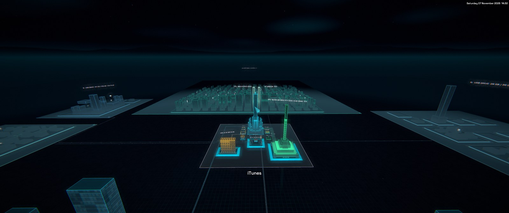
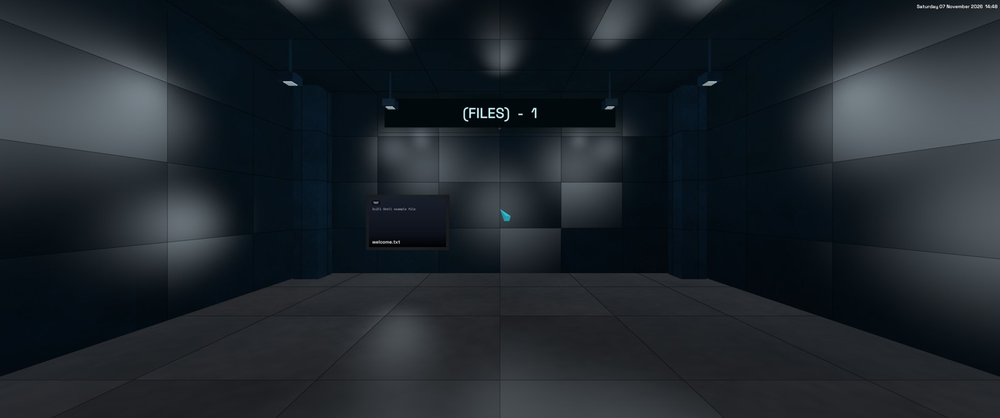
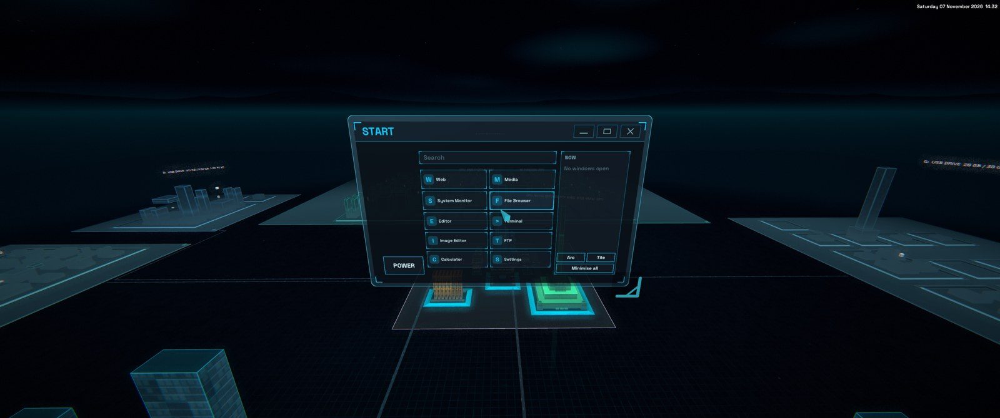
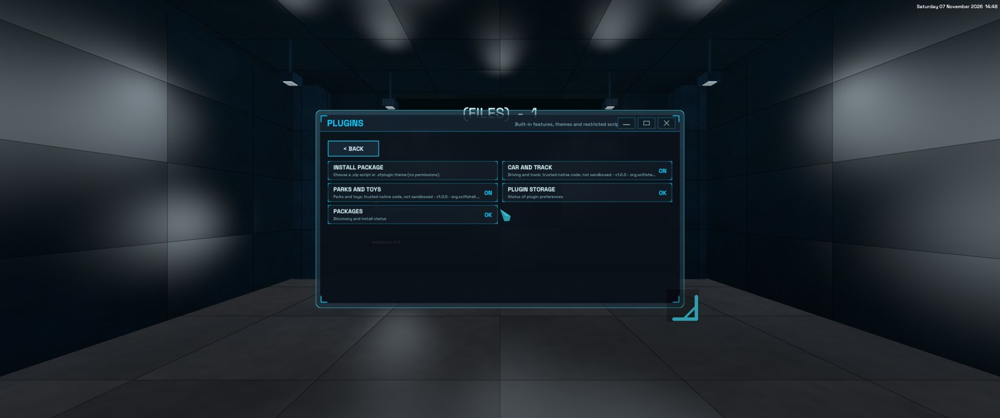
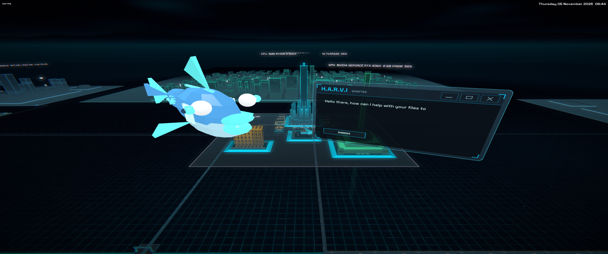
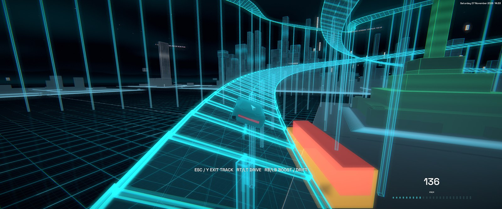
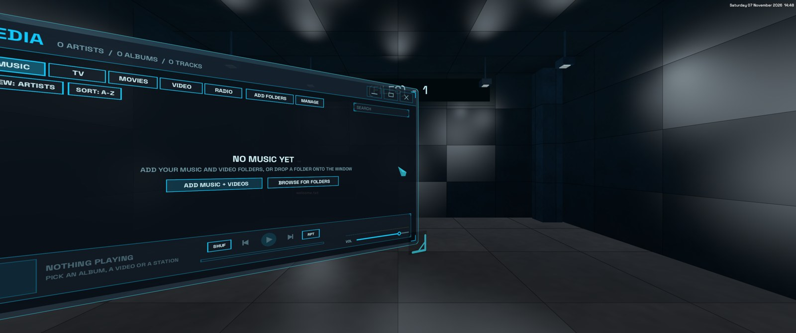

# SciFiShell

### *Your computer, as a neon city. Fly through it. Ride your data.*

SciFiShell turns your PC into a glowing, dark, neon-grid 3D city. Every drive is a district, every folder a
building, every file a card on a wall. Your CPU, GPU, RAM and storage are landmarks wired together by
**bus lanes** with live data packets racing along them. Browse your files, play your music and video, surf the web,
and just *fly around inside your own machine*.

## Contents

- [Get it and updates](#get-it-windows)
- [Controls](#controls)
- [Quick tutorial](#quick-tutorial)
  - [Doors, lobbies and rooms](#doors-lobbies-and-rooms)
  - [Ride the bus lanes](#ride-the-bus-lanes)
  - [Play in the city](#play-in-the-city)
- [Plugins and Lua authoring](docs/plugins.md)
- [Built-in tools](#built-in-tools)
  - [Media player](#media-player)
- [Window management](#window-management)
- [What's coming](#whats-coming)
- [Development guide](docs/development.md)

## Get it (Windows)

1. Download the installer from the **[latest release](https://github.com/Davidalanfisk/SciFiShell/releases/latest)**.
2. Run the installer; it is currently unsigned, so Windows may display a security warning.
3. Launch the **installed** SciFi Shell shortcut. The installed copy checks GitHub at startup and asks before installing a newer release; connectivity or other check failures are silent. The Windows Start menu entry **Check for SciFi Shell updates** also reports errors and when you are up to date.

**Source builds do not update themselves.** If your taskbar pin points into a source checkout's `build\Release` folder, it will continue to run that build and will not prompt. To use releases instead, install the latest release, launch it from its Start menu shortcut, and pin that installed copy yourself. This does not update or overwrite the source checkout. Alternatively, update and rebuild your source checkout yourself. Existing pins are not automatically changed.

## Controls

**Mouse & keyboard**

| Do this | By |
|---|---|
| Move | `W` `A` `S` `D` |
| Look around | Move the mouse |
| Jump | `Space` |
| Fly on/off | Double-tap `Space` |
| Fly up / down | `Space` / `Left Ctrl` |
| Go faster | Hold `Left Shift` |
| Select / open / click | Left mouse button |
| **Open / close the Start menu** | **Middle mouse button** or `F2` (works anywhere, even with apps open) |
| Back / close | `Esc` or `Backspace` |
| Browser | `B` |
| Fullscreen media | `F` |
| Edit text file / save | `E` / `Ctrl+S` |
| Cycle colour theme | `F6` |
| Toggle VR | `V` |
| On-screen keyboard | `F7` |
| Arrange windows (arc, then tiles) | `F8` (remap in Settings → Windows → Arrange Key) |
| Show / hide the city | `F9` (also Settings → Graphics → City) |
| Screenshot | `F12` (saved to `Pictures\SciFiShell`; visible overlapping windows can appear) |
| Summon / exit the car | `F10` |
| H.A.R.V.I assistant (summon / dismiss) | `F1` (or `Esc`) |
| Car: drive / drift / boost / camera | `W` `A` `S` `D` / `Space` / `Shift` / `C` |
| Hot dog / ice cream stand: take one, then throw it | Click the stand, click again |

**Xbox controller:** left stick move · right stick look (snap turn in VR) · **RT / LT** up / down · **A** select · **B** back · **Y** Start menu · **X** on-screen keyboard · **LB / RB** previous / next window (then **A**). While driving: **RT / LT** accelerate / brake, left stick steers, **RB / LB** boost / drift; **Y** exits the car or exits a stunt-track lap.

**VR headset only (no controllers needed):** a gaze reticle aims; use mouse, keyboard or Xbox pad for everything else. The on-screen keyboard (`F7`) floats in front of you and pops up when a text field is focused. Picking up a controller switches aiming to its ray; touching mouse, keyboard or pad switches back to gaze.

**VR controllers (OpenXR):** right ray + trigger select · left stick / trackpad move (the way you face) · right stick / trackpad: left-right snap turn, up-down altitude · left menu / Y / B Start menu · right menu / B back · left grip or X / A on-screen keyboard · right grip window switcher (trigger confirms)

**City layout:** each region is a solid-floored district with hexagon-paved main roads, grey pavements, paths, parks with ponds, trees and benches, and street lights. The machine's own components (hub, CPU, RAM, GPU, cache) sit in a white region at the centre. PCIe buses run at street level and only rise onto bridges to cross one another; stations are street-level plazas with read/write meters at their gates. Very large folders (more than 24 subfolders or 120 items) open as their own multi-floor lobby with a lift, and loose files stay together in one room that adds a floor (three rows of frames each, with a walkable gallery ledge and a glass lift in the corner) as the folder grows. Hovering a video frame for a moment plays a muted live preview in place.

**Window management:** open windows follow you between the city, lobbies and rooms, gliding to a comfortable spot in front of you. Aim at the bracket at a window's bottom-right corner to resize it (hold and drag with the mouse; with a pad or VR controller click to grab, move, click to drop). While dragging a window the mouse wheel pushes it away or pulls it closer, and it snaps to the edges, plane and eye height of its neighbours. `F8` or **Settings → Windows** curves every open window around you in an arc, or lays them out as tiles. Carrying and snapping can be switched off there too.

**HUD:** a plain white readout shows the time and date (top right). In the city, the name of the building or monument under your aim appears below the crosshair.

## Quick tutorial

You start in the city, standing at the hub. The big tower in the middle is your **system core**, and the districts
around it are your drives. **Walk** with WASD, or **double-tap Space to fly** and take in the skyline.

- **Open a drive or building:** look at it and click. Step through the door and you're in a *file room*: every file
  is a card on the wall. Click a folder card to go deeper, `..` to go up, and use the grand exit doors to get back to
  the street. A folder with only one sub-folder skips the lobby and drops you straight into its room, with the exit
  door taking you back out to the city.
- **Lifts:** tall buildings have multiple floors. Press the call button outside the lift, step in, and choose a floor
  from the buttons inside.
- **View things:** click an image or text file to open it in the viewer; videos and audio open in the built-in media player, on the right tab. Long-click a card to lock
  your view onto it. Press `E` on text to edit, `Ctrl+S` to save, `F` for fullscreen.
- **Ride the bus lanes:** click any bus lane and you'll be sucked into it and carried like a packet of data all the
  way to the far end of the route (the end farthest from where you clicked), a fast way to cross the city. Lanes are raised gantry bundles with realistic lane counts, and you can also walk along them.
- **The Start menu:** middle-click (or `F2`) any time to open it. From here open **Web**, **Media**, Settings and the other built-in tools.
- **Media player:** music, video and live radio in one window. Add folders (or drop them on the window), browse by
  album, watch video fullscreen, and keep the music going in the background while you explore - see
  [Media player](#media-player).
- **Browser:** a real web browser (Chromium) floating in your world.
- **Idle tour:** leave it alone for 10 seconds and the camera takes you on a cinematic flight through the city. Touch
  any control to take over again.

### Doors, lobbies and rooms
Every folder is a building and every sub-folder a door. Doors show a large thumbnail (videos use a frame from about
20% in) with the name below; hover a door to swap the name for extra details while the thumbnail stays put. Lobbies
and rooms fill the far wall first, then the side walls, and the exit wall last. Inside a room, sub-folders stay as
tall doors while files hang on the walls as framed pictures. Rooms are lit by dim spot lights rather than ceiling panels.

The city also watches for drives being connected or removed: new drives fade in as regions, removed drives fade away,
and all regions fade in when the city first loads. Fullscreen apps use a normal 2D mouse pointer, and the media
player's **Add Folders** uses the built-in file browser instead of the Windows picker.

Rooms are dark, panelled halls with a reflective floor, glowing trim and tiered shelves of cards. A faint ring of
mountains encircles the grid on the horizon, and building labels are depth-sorted so they are never clipped.

### Ride the bus lanes
Click a bus lane to ride it: you travel along it like a data packet, always to the end farthest from where you clicked. Lanes are overhead gantry bundles (DMI, PCIe x16, memory, NIC, USB and one per drive) that you can also walk on. Each storage lane ends at a monorail-style station with a staircase down onto the region platform; a ring of shallow steps round every region lets you walk up anywhere.
Districts sit on glass-pane floors with a neon outline, and the whole city has a dark, moody grade.

### Play in the city
Ground-level fog drifts between the towers (tune it with the fog sliders in Settings > Graphics), and the parks have wireframe neon ducks paddling around their ponds.

**Hot dog and ice cream stands.** Click a stand to be handed a neon-outline snack, held just off to one side. Click again to lob it like a grenade: five seconds later it bursts in a neon explosion that shoves you back if you're close. Blow up a duck and a score pops up on your HUD. Every effect has a synthesised retro sound.

**The car.** Press `F10` anywhere in the city to summon a neon hologram sports car, and `F10` again to leave it. `C` swaps first and third person; `Space` drifts and `Shift` boosts. A speedo appears on the HUD. The wheels steer and spin, and a quiet electric hum rises with speed. Parked, it is solid: you can stand on it. Ramps on every region let you drive up onto the platforms.

**Make a plugin.** The Windows x64 build **v0.9.22** supports data-only themes, Lua message scripts, and experimental Lua gameplay plugins, including persistent storage, controller input, audio samples, local messages and procedural meshes. Plugin manifests and Lua source files now accept up to **10 MiB each**, with bounded Lua compilation and runtime memory. Start with the [plugin developer guide](docs/plugins.md): it walks through installation, a first gameplay plugin, packaging, permissions, limits and the API, including the [v0.9.22 changelog](docs/plugins.md#v0922-changelog). Try the downloadable [clock](https://github.com/Davidalanfisk/SciFiShell/releases/download/v0.9.19/scifishell-clock-example.zip), [scripted car and track](https://github.com/Davidalanfisk/SciFiShell/releases/download/v0.9.20/scripted-car-track.zip), or [scripted parks and toys](https://github.com/Davidalanfisk/SciFiShell/releases/download/v0.9.20/scripted-parks-toys.zip) in **Settings > Plugins**. The gameplay examples are simplified, not replacements for the separately enabled native Car and Track and Parks and Toys. Scripts and asset decoders run in the shell process, not an OS sandbox; only install and enable packages you trust.

**H.A.R.V.I.** Press `F1` and a holographic fish materialises beside a dialogue panel: quick tour, controls, troubleshooting, "Did you know?" tips, and shortcuts that open tools and settings pages. He gives contextual help when summoned over Settings or while driving. His lips, eyes, gills, fins and tail are individually articulated: the jaw lip-syncs to the text as it types out, and he blinks, looks around, and emotes (happy, confused, thinking, surprised, sad) and gestures (nod, shake, spin, hop, wave).

Dialogue lives in `assets/harvi/dialogue.json` (`start`, `nodes{id:{say, emote, buttons[{label, action, goto}]}}`, `tips[]`), so it is easy to extend. Button actions include `tool:settings`, `tool:media`, `page:FOG`, `key:arrange`, `tip` and `dismiss`. The "brain" is an interface (`HarviBrain`); the scripted brain is the default and an LLM brain can be slotted in later. Scripts can drive him with `tool harvi on|off|say TEXT|emote NAME|gesture NAME|node ID|ctx NAME`.

**The race track.** While you're driving, a roughly 3 km neon track fades in. Drive up the ramp beside the CPU region, then ride it through the city with loops, and the driver assist keeps you on it. It fades out when you leave the car.

The city, Start menu, file room, plugin settings, track and media screenshots were captured from the current build with isolated profiles; other illustrations are earlier captures. The file room and media screenshots use sample data and an empty library.

## Built-in tools

Everything below is launched from the **Start menu** (middle-click or `F2`). Windows open in front of you, the camera
gently turns to face them and stays put until you move.

| Tool | What it does |
|---|---|
| **Web** | A real Chromium browser floating in your world. |
| **Media** | Music, video and live radio with a scanned library, fullscreen video and background playback. |
| **System Monitor** | Live CPU, memory, GPU, per-thread load, top processes, network and drives. Also opens when you click the **CPU building**. |
| **File Browser** | A classic 2D file manager: places, drives, search, sorting, copy / cut / paste, rename, delete (to the Recycle Bin), and **Open in 3D Room**. |
| **Editor** | A text editor that always starts with a blank document: New, Open, Save, Save As. |
| **Image Editor** | Opens images (also from file rooms): a file bar along the top, an icon toolbox with tooltips on the left (brush, eraser, fill, shapes, text, picker, crop, pan and more), text buttons for transforms and adjustments on the right, mouse-wheel zoom and a pan tool, undo/redo, save as PNG/JPG/BMP, plus a **shot timer** that hides the window and saves a screenshot to Pictures\SciFiShell. |
| **FTP** | A basic FTP client: host / user / password (anonymous if empty), browse, download to Downloads, upload via the in-app file picker. |
| **Calculator** | Standard, Scientific (trig, logs, powers, factorial, DEG/RAD) and Computer (64-bit HEX / DEC / OCT / BIN, bitwise operators, clickable bit grid) modes, with full keyboard input. |
| **Terminal** | PowerShell, CMD or WSL in a window (Windows 10 1809+). |
| **Settings** | Shell preferences plus Windows controls: display, sound, network, mouse, themes, power, and the media player. |

### System Monitor

### File Browser

### Image Editor

### FTP

### Calculator

### Terminal

### Editor

### Media player

Browse music and video, play live radio and manage your library. See the [media player guide](docs/media.md) for setup, playback and library details.

## Window management

Every tool opens as a free-floating window, and they all share one set of window controls: drag the title bar to move, the corner bracket to resize, and `F8` to arrange.

*Windows wherever you left them.*

*Arc: windows curve around you at a comfortable distance, each facing you.*

*Tiles: a grid of equally sized cells, each window scaled to fit.*

## What's coming

*"I tried to picture clusters of information as they moved through the computer."*

This is only the first lap. The grid is about to get **gnarly**:

- **A better music visualizer:** a hardware-accelerated, projectM-based visualizer for the media player. See the
  [plan](docs/visualizer-plan.md). Meanwhile, click the spectrum in the now-playing bar to cycle four built-in styles
  (bars, mirrored, radial, dot matrix).
- **Networking:** link up cities across the wire. Your machine, your friends' machines, one shared grid.
- **Shared spaces:** VR-chat-style hangouts where you and your crew drift through each other's data, together.
- **Customisable apartments:** GTA-style personal pads inside the city. Decorate, hoard, show off.
- **Seamless games:** step through a door and you're *in* the game. No launcher, no loading screen, just the grid
  rewriting itself around you.
- **3D object importing:** drop models straight into your world and watch them materialise on the grid.
- **Worlds within worlds:** buildings that contain cities that contain buildings. Biodigital jazz, man. The sky is
  the limit, and the sky is also made of code.

*End of line.*

---

## Development

See the [development guide](docs/development.md) for dependencies, CEF setup, building, scripting, packaging and technical notes.
