# SciFiShell

### *Your computer, as a neon city. Fly through it. Ride your data.*

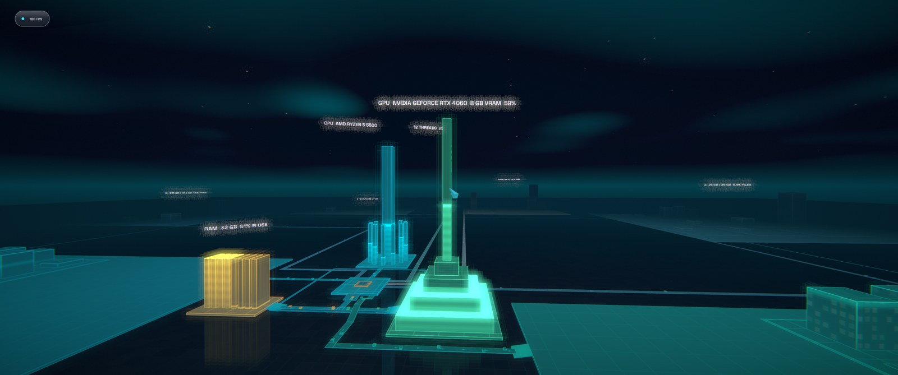

SciFiShell turns your PC into a glowing, dark, neon-grid 3D city. Every drive is a district, every folder a
building, every file a card on a wall. Your CPU, GPU, RAM and storage are landmarks wired together by
**bus lanes** with live data packets racing along them. Browse your files, play your music and video, surf the web,
and just *fly around inside your own machine*.

## Get it (Windows)

1. Download the installer from the **[latest release](https://github.com/Davidalanfisk/SciFiShell/releases/latest)**.
2. Run it. Windows SmartScreen may warn because the installer isn't code-signed yet: **More info → Run anyway**.
3. Launch **SciFiShell**. Updates are offered automatically on start-up, so you'll always get the newest build.

## Controls

**Mouse & keyboard**

| Do this | By |
|---|---|
| Move | `W` `A` `S` `D` |
| Look around | Move the mouse |
| Jump | `Space` |
| Fly on/off | Double-tap `Space` |
| Fly up / down | `Space` / `Left Ctrl` |
| Go faster | Hold `Left Shift` |
| Select / open / click | Left mouse button |
| **Open the command ring** | **Middle mouse button** or `F2` (works anywhere, even with apps open) |
| Back / close | `Esc` or `Backspace` |
| Browser | `B` |
| Fullscreen media | `F` |
| Edit text file / save | `E` / `Ctrl+S` |
| Cycle colour theme | `F6` |
| Toggle VR | `V` |
| Screenshot | `F12` (saved to `Pictures\SciFiShell`) |

**Xbox controller:** left stick move · right stick look · **A** select · **B** back · **Y** command ring
**VR (OpenXR):** ray + trigger to select · left thumbstick to move · menu button for the ring

## Quick tutorial

You start in the city, standing at the hub. The big tower in the middle is your **system core**, and the districts
around it are your drives. **Walk** with WASD, or **double-tap Space to fly** and take in the skyline.

- **Open a drive or building:** look at it and click. Step through the door and you're in a *file room*: every file
  is a card on the wall. Click a folder card to go deeper, `..` to go up, and use the grand exit doors to get back to
  the street.
- **Lifts:** tall buildings have multiple floors. Press the call button outside the lift, step in, and choose a floor
  from the buttons inside.
- **View things:** click an image, text file, video or audio card to open it in the viewer. Long-click a card to lock
  your view onto it. Press `E` on text to edit, `Ctrl+S` to save, `F` for fullscreen.
- **Ride the bus lanes:** click any bus lane and you'll be sucked into it and carried like a packet of data all the
  way to the end of the route, a fast way to cross the city. Each bus is dual-lane: one channel in, one out.
- **The command ring:** middle-click (or `F2`) any time to summon it. From here open **Web**, **Media**, **Windows
  Apps** and Settings. You can run several apps at once, and the ring is always available.
- **Media player:** a Winamp-style player for audio *and* video. Point it at your media folders, let it scan into a
  library, build playlists, and keep the music going in the background while you explore.
- **Browser:** a real web browser (Chromium) floating in your world.
- **Idle tour:** leave it alone for 10 seconds and the camera takes you on a cinematic flight through the city. Touch
  any control to take over again.

### Doors, lobbies and rooms
Every folder is a building and every sub-folder a door. Doors show a large thumbnail (videos use a frame from about
20% in) with the name below; hover a door to swap the name for extra details while the thumbnail stays put. Lobbies
and rooms fill the far wall first, then the side walls, and the exit wall last.

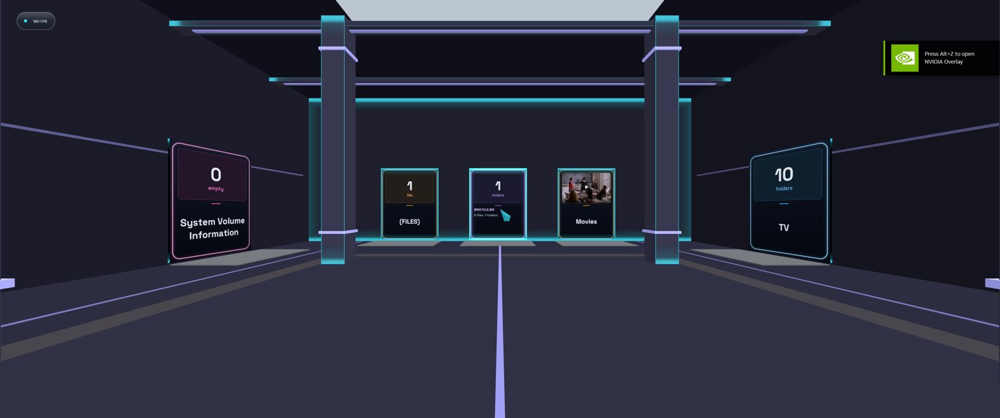
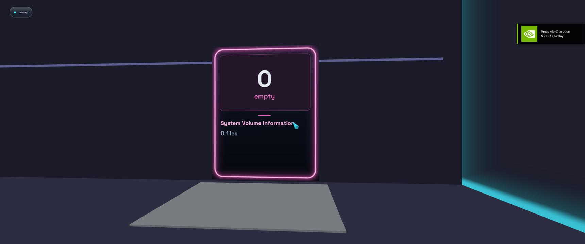

### Ride the bus lanes
Click a bus lane to ride it: a chase camera follows you along the lane network with a glowing trail.
Districts sit on glass-pane floors with a neon outline, and the whole city has a dark, moody grade.

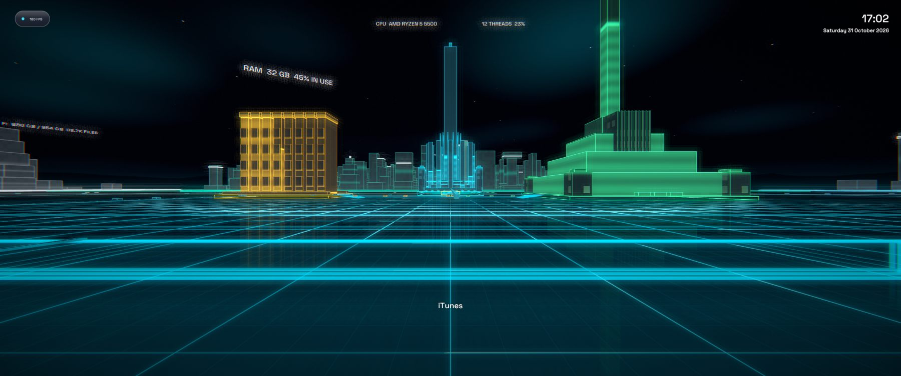
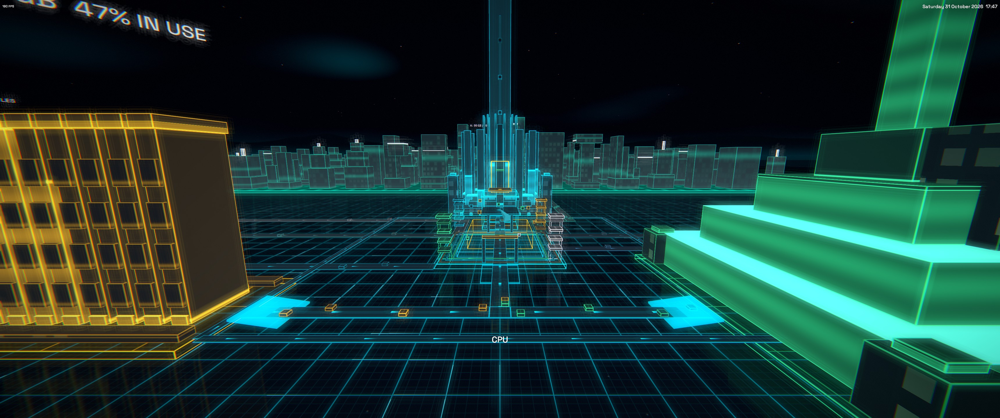
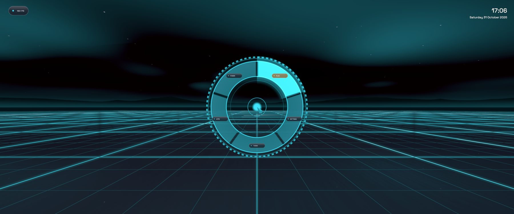
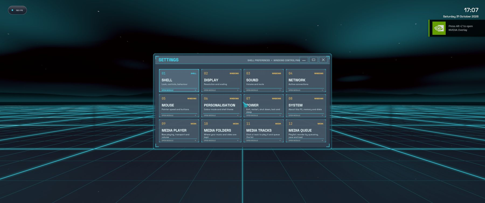

## Built-in tools

Everything below lives on the **command ring** (middle-click or `F2`). Windows open in front of you, the camera
gently turns to face them and stays put until you move.

| Tool | What it does |
|---|---|
| **Web** | A real Chromium browser floating in your world. |
| **Media** | Winamp-style audio and video player with a scanned library, playlists and background playback. |
| **System Monitor** | Live CPU, memory, GPU, per-thread load, top processes, network and drives. Also opens when you click the **CPU building**. |
| **File Browser** | A classic 2D file manager: places, drives, search, sorting, copy / cut / paste, rename, delete (to the Recycle Bin), and **Open in 3D Room**. |
| **Editor** | A text editor that always starts with a blank document: New, Open, Save, Save As. |
| **Terminal** | PowerShell, CMD or WSL in a window (Windows 10 1809+). |
| **Windows Apps** | The apps and windows already open on your PC, ready to switch to. |
| **Settings** | Shell preferences plus Windows controls: display, sound, network, mouse, themes, power, and the media player. |

### System Monitor
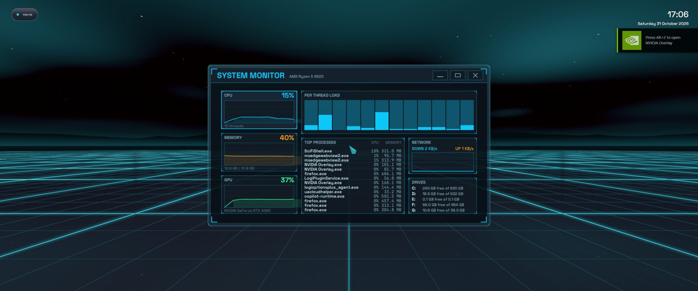

### File Browser
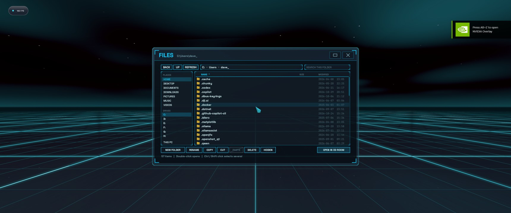

### Terminal
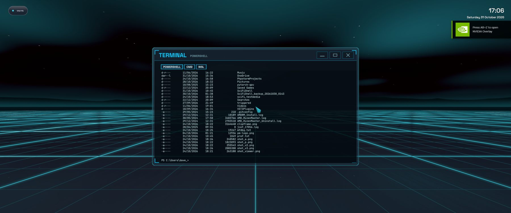

### Editor
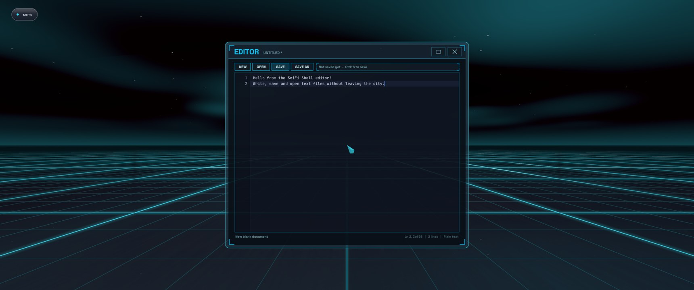


## What's coming

*"I tried to picture clusters of information as they moved through the computer."*

This is only the first lap. The grid is about to get **gnarly**:

- **Networking:** link up cities across the wire. Your machine, your friends' machines, one shared grid.
- **Shared spaces:** VR-chat-style hangouts where you and your crew drift through each other's data, together.
- **Customisable apartments:** GTA-style personal pads inside the city. Decorate, hoard, show off.
- **Seamless games:** step through a door and you're *in* the game. No launcher, no loading screen, just the grid
  rewriting itself around you.
- **3D object importing:** drop models straight into your world and watch them materialise on the grid.
- **Worlds within worlds:** buildings that contain cities that contain buildings. Biodigital jazz, man. The sky is
  the limit, and the sky is also made of code.

*End of line.*

---

# For developers

## Dependencies

| Dependency | Source |
|---|---|
| CMake >= 3.20, C++17 compiler, git, Python 3 (needed by Diligent's build) | system |
| Diligent Engine (DiligentCore) | fetched automatically by CMake (`FetchContent`, needs network) |
| OpenXR loader | fetched automatically (OpenXR-SDK) |
| SDL2 (dev package) | Windows: `vcpkg install sdl2`; Linux: `libsdl2-dev`; macOS: `brew install sdl2` |

Backends: **Direct3D 12** (Windows), **Vulkan** (Linux, X11 session or XWayland; needs the Vulkan SDK/drivers),
**Metal** (macOS).

## Build

Windows (Visual Studio 2022, vcpkg):
```
cmake -S . -B build -DCMAKE_TOOLCHAIN_FILE=%VCPKG_ROOT%/scripts/buildsystems/vcpkg.cmake
cmake --build build --config Release
build\Release\SciFiShell.exe
```

Linux:
```
sudo apt install build-essential cmake libsdl2-dev libx11-dev libxrandr-dev libxinerama-dev libxcursor-dev libxi-dev libvulkan-dev
cmake -S . -B build -DCMAKE_BUILD_TYPE=Release && cmake --build build -j
./build/SciFiShell
```

macOS:
```
brew install cmake sdl2
cmake -S . -B build -DCMAKE_BUILD_TYPE=Release && cmake --build build -j
./build/SciFiShell
```

Pin a Diligent release with `-DSCIFI_DILIGENT_TAG=<tag>` (default `master`). Shaders are copied next to the
executable (`shaders/`) and compiled at start-up.

Inside a file room the `..` card goes to the parent folder (or back to This PC from a drive root); folder cards open
that folder.

## Web browser + 3D Web Depth Compositor (Windows)

Press **B** in the File Room to open a Chromium (CEF, off-screen) browser panel in front of you. Pages are rendered to a
texture; the pointer ray / mouse maps 3D hit -> page pixel -> CEF events. Setup: CEF 156 (Windows 64 "minimal") is
extracted to `third_party/cef`; CMake builds the wrapper automatically and copies the runtime next to the exe. If the
folder is missing the shell builds without a browser. The project now builds as C++20 (required by CEF).

- Toolbar: back / forward / reload / address (click or `Ctrl+L`, Enter to go; plain text searches DuckDuckGo) /
  depth chip / site chip / close. `Alt+Left/Right` back/forward, `F5` reload, `Esc` leaves the address bar,
  pad **B** / VR back closes the panel (page stays alive). Pad/VR stick scrolls, **A**/trigger clicks, wheel scrolls.
- Keyboard: WASD/Space/Ctrl keep flying the camera while the browser is open. Keys go to the page only while a text
  field (or the address bar) has focus; arrows/PageUp/PageDown/Home/End always scroll the page.
- **Depth effects** (`F3` cycles Off / Subtle / Cinematic, `F4` toggles the current site): a read-only injected script
  finds images, video/iframes and stacking contexts and sorts them into 4 depth bands. The compositor draws extra
  quads sampling the same page texture (raised images/video with rim light, soft card shadows, per-band parallax from
  mouse/head). The DOM is never modified and input always hits the base page plane.
- Settings persist in `%LOCALAPPDATA%\SciFiShell\webdepth.ini` (`mode=`, `disable=<host>`).
- Safeguards: analysis runs only after load/input (debounced, <=40 ms budget), caps on cards/media, pages that are too
  complex fall back to a single plane, layers flatten while the layout is stale, and in VR depth is halved and cards
  dropped when frame time exceeds ~14 ms.
- Limitations: no dropdown popups or right-click menu, no video curvature, only Ctrl+V clipboard paste.

## Neon/LCARS look, tool ring and themes

- **The Grid**: dark void with a glowing grid floor; file cards have accent edge lights (brighter on hover).
- **Tool ring**: open with **middle click**, **F2**, **pad Y** or **left Y/B/menu button in VR**. Look at a segment (or use the mouse wheel / d-pad / arrow keys) and click / **A** / trigger to launch: Files, Settings, Theme, Apps, Power. Apps opens a second ring outside the first with WEB, EDITOR (first text file in the room), MEDIA (first image/video/audio) and WINDOWS; WINDOWS swaps that ring for small transparent icons of your pinned taskbar apps. Esc / B steps back one level. There is no City segment: the city is always loaded. Esc / B / the open button closes it.
- **Themes**: Cyan, Amber, Magenta. Cycle with **F6** or the ring's Theme segment; the choice is saved in `%LOCALAPPDATA%\SciFiShell\theme.ini`.
- **Screenshots**: press **F12** to save the shell window as a PNG in `Pictures\SciFiShell` (you'll hear a beep; nothing is drawn on screen).
- **Settings**: the ring's Settings segment opens a card based hub (aim + click / A / trigger to open a card, arrow keys / d-pad / wheel to move, Esc / B goes back, then closes). The **SHELL** card holds the app options (VR mode, theme, look sensitivity, move speed, invert look Y, crosshair, FPS counter, browser resolution, exit), saved to `%LOCALAPPDATA%\SciFiShell\settings.ini`. On Windows the other cards are native replacements for the Control Panel (no hosted Windows pages): Display (resolution/scaling info), Sound (volume up/down, mute), Network (active adapters and IPs), Mouse (pointer speed, swap buttons), Personalisation (Windows dark mode, shell theme), Power (battery, lock, sleep) and System (PC name, Windows, CPU, memory, uptime, clock, drives). System and Display cards are read-only. Not covered yet: changing resolution, brightness, Bluetooth, Wi-Fi networks, night light, app management.
- **Windows (desktop)**: the browser, apps, built-in tools (monitor, terminal, files, editor), settings and the media viewer are all glass windows that behave the same way and stay open until you close them, so you can arrange as many as you like. New windows fan out in front of you. Click a window to raise it and give it the keyboard (the frontmost one under the aim takes the mouse; the world, doors and bus lanes still work around windows). **Drag** any window by its header (or the empty parts of the browser toolbar) to reposition it. Header buttons: minimise (hides it, restore from Alt+Tab or the ring), fullscreen, close. **Right click** a window to pin the view to it (the camera glides to centre it and the mouse moves a cursor); right click again, press Esc or click empty space to look around freely. Esc / pad B steps back inside the focused window (leaves the address bar or fullscreen, goes up a page) and never closes it. The middle mouse button / F2 only opens the command ring. Alt+Tab lists every window. VR keeps pointing with the controller.
- **Applications (Windows)**: the ring's Apps segment shows an outer ring of icons (from the shell) for Notepad plus every program pinned to your Windows taskbar (`SCIFI_OPEN_APPS=1` opens it at start for debugging; the pin list is read from (read from `%APPDATA%\Microsoft\Internet Explorer\Quick Launch\User Pinned\TaskBar`). Several programs can be open as panels at once; the panel under the pointer takes the keyboard. Caveats: single-instance apps that hand off to an already-running process, apps with splash windows, and elevated apps (e.g. Task Manager) may fail to attach or pick the wrong window. The program runs normally but its window is parked off-screen and mirrored onto a floating panel. Aim + click to use it; once clicked, the keyboard (typing, Ctrl+C/X/V/A/Z) goes to it (hold Alt to walk). Esc / B hides the panel (program keeps running); the X on the panel's bar closes the program, – hides it. Input to the program's text area is injected as window messages; tabs, buttons and menus are clicked through UI Automation by the `SciFiUia.exe` helper (built next to `SciFiShell.exe`, must stay beside it). Menus/flyouts are mirrored into the panel. The hosted window is marked non-activating so clicking it never steals the foreground (and mouse capture) from the shell. There are no hover highlights. **Moving**: press and hold the panel's title bar (the dark strip, not the buttons) and aim around: the panel follows the pointer at the same distance and turns to face you; release to drop it (mouse only; pad/VR taps don't drag yet). **Fullscreen**: F11 or the square button on the panel's bar makes the program fill the screen (the window is resized to the screen's shape; the mouse / right stick move a pointer over it, the room is frozen); Esc / B / F11 returns. **Task switcher**: Alt+Tab (or Ctrl+Tab, which always works) opens a strip of cards (Room, each running program, Browser, Desktop); keep Alt/Ctrl held and press Tab (Shift+Tab goes back) or ←/→ to choose, release to switch; Esc cancels; Desktop minimises the shell. The shell grabs the keyboard so Alt+Tab (and the Win key) reach it instead of Windows; Ctrl+Tab therefore no longer reaches Notepad's tabs.
- **City** (the home view - the app starts here): a neon-grid city generated from this PC (fly with the usual controls at 8x speed; buildings and the CPU/RAM/GPU monuments are solid. Aim at a tower and click to enter it (opens that folder as a file room; Esc returns to the city). Windows open on top of the city. CPU (spire + per-core pillars), RAM (slab bank) and GPU (ziggurat + VRAM pylon) sit in the middle and show live load; each fixed/removable drive is a platform sized by its capacity, with a lit pad for used space and one tower per top-level folder (height ~ file count, width ~ bytes), joined to the core by roads. A background scan starts ~1.5 s after launch (so it has usually finished listing by the time you open the city) and the city rises out of the grid the first time you view it. A `ReadDirectoryChangesW` watcher per fixed drive flashes towers (green = added, red = removed) with a beam and resizes them. GPU load/VRAM come from Windows performance counters; if unavailable they fall back to a gentle animation. `SCIFI_OPEN_CITY=1` opens it at start (debug). Click a bus lane (or run the `ride N` script command) to ride along it with a chase camera and a glowing trail; any movement input, click or Esc gets you off.
- Limitations: fog, bloom and audio cues are shader approximations / not implemented; the viewer, web toolbar and editor panels use baked colours and don't follow the theme yet. `SCIFI_OPEN_RING=1` opens the ring at start (debug).

## Notes / limitations

- VR rendering is implemented for the **Direct3D 12 + OpenXR (SteamVR)** path, i.e. Windows. On Linux/macOS the
  "VR MODE" entry reports that VR needs the Windows D3D12 build and the shell continues in desktop mode.
- Hold Left Shift to move 30% faster.
- Media viewer: click an image/video/audio card (or Enter) and it flies forward, expands with details, and starts playing.
  Click the bar controls (play, seek, fullscreen, close), or use Space pause, Left/Right seek 5 s, Up/Down volume,
  F fullscreen, Esc/Backspace/pad B to exit fullscreen then close.
- Text editor: click a text/code card to open it in the viewer with syntax highlighting (C/C++, JS/TS, Python, JSON,
  HTML/XML, CSS, SQL, Markdown, shell, and more). Mouse wheel / Up / Down / PgUp / PgDn / stick scroll. Press **E**,
  click the pencil or click the text to edit (arrows, Home/End, Ctrl+Home/End, Tab, Ctrl+V paste, click to place the
  caret); **Ctrl+S** or SAVE writes the file; **Esc** leaves edit mode. Closing with unsaved changes asks you to close
  again to discard. Files over 2 MB or binary files open read only.
- The viewer panel is drawn over the room, so it no longer clips into nearby cards.
- Text uses Space Grotesk / Inter / JetBrains Mono from `assets/fonts` (copied next to the exe).
- File Room cards show thumbnails: images (JPG/PNG/etc. via stb_image), video first frames (Windows Media
  Foundation; MKV/WebM may lack codecs), audio cards, and text previews. They load on a background thread.
- Thumbnails are cached as PNGs in `%LOCALAPPDATA%\SciFiShell\thumbs` (`~/.cache/scifishell/thumbs` elsewhere), keyed
  by path, size and modified time; delete the folder to rebuild them.
- Debug env vars: `SCIFI_START_PATH=<dir>`, `SCIFI_CAM_YAW=<degrees>`, `SCIFI_START_MENU=1` (old start menu).
- The project was written without access to a build environment; Diligent's API evolves, so if a call no longer
  matches, pin `SCIFI_DILIGENT_TAG` to a release from the same period as the code.

## Latest additions
- Animated cloud sky in the theme's base colour; the floor grid fades into a horizon mist at any distance.
- Desktop fullscreen (F / bar button): the media fills the whole screen, controls fade after 3 s and return on any input. Images: mouse wheel or Xbox triggers zoom, drag to pan; next/previous stays fullscreen. Mouse / right stick move an on-screen cursor. Esc / B leaves fullscreen. D-pad left/right seeks video/audio.
- Taller file ring (up to 1000 files), bigger flyable room.
- With a file open: click another card to switch, click empty space to close; prev/next arrows on the control bar (Left/Right keys for images).


## Power, blocks and file rooms

- **POWER** on the tool ring (or Settings > Power): exit shell, restart or shut down (restart/shutdown need a second click to confirm).
- City: a drive's top-level folders are city blocks; their subfolders are buildings (loose files form a (FILES) building). Buildings have wide bases (12-19 m) on raised sidewalks, with lane-marked streets between rows and columns of buildings.
- Clicking a non-media file opens its file room: details plus OPEN, COPY FILE, COPY PATH, SEND TO DESKTOP, DUPLICATE, RENAME (via Explorer), REVEAL IN EXPLORER and DELETE (Recycle Bin, confirm). Media and text files still open in the fullscreen viewer.


## Building interiors

Entering a building puts you in an atrium (with a fountain in the middle when it has 3+ floors). Each subfolder (plus a "(FILES)" room for loose files) is a door set into the walls. Each floor holds at most 40 doors; bigger buildings stack as many floors as needed, each with a glass-railed walkway and a glass lift on the far wall (walk up to the shaft and the car comes to your level; step in and press a level button inside; there is one CALL button on the wall beside each shaft door). The entrance wall carries doors too (filled last, after the other walls), around a grand glowing EXIT door whose whole doorway is the exit trigger. A room holding just one subfolder is entered automatically. Ceilings carry a single skylight, no strip lights. Doors share a thin white neon outline (round top, square bottom), with labels only on the front face. The lift is recessed so its doors sit flush with the far wall. Movement is Minecraft-creative style, in buildings and the city: Space jumps, double-tap Space toggles flying, then Space rises and Left Ctrl descends; touching a floor ends the flight. Leaving a building puts you on the street outside its door; every city building has a door on its +z face labelled with its folder name. The view only locks onto an image card or window after a long click. The atrium holds no file objects; each door shows its room title, a preview thumbnail and a summary (file counts by type, sample names). Click a door to enter: the gallery room is built on entry, sized by its file count and hung with framed thumbnails that load as you approach. Click a frame to open/play a file (or open a subfolder as a new building). Esc steps back room -> lobby -> city. Walls are solid.

## City cache

The scanned city layout is cached in `%LOCALAPPDATA%\SciFiShell\city.cache` so the city appears immediately on launch; a background rescan then updates it. Folders created after the cache was saved appear on the next run.

## File panel

Clicking a file frame opens a panel with details and actions (open, copy, send, duplicate, reveal, delete). RENAME is done in-app: choose it, type the new name, Enter to apply, Esc to cancel.

## Installer and updates (Windows)

- Build the installer (needs Inno Setup: `winget install -e --id JRSoftware.InnoSetup`): build Release first, then
  `powershell -ExecutionPolicy Bypass -File .\installer\build-installer.ps1 -Version 0.1.0` -> `installer\Output\SciFiShell-Setup-0.1.0.exe`. It installs per-user to `%LOCALAPPDATA%\Programs\SciFiShell` (or Program Files if you choose "all users"), with Start menu / optional desktop shortcuts.
- Publish a release: `powershell -ExecutionPolicy Bypass -File .\installer\build-installer.ps1 -Version 0.2.0 -Publish` (uses `gh release create v0.2.0`, attaching the installer to the public repo `Davidalanfisk/SciFiShell`).
- Updates: an installed shell runs `update.ps1` hidden at launch. It asks GitHub for the latest release, and if the tag is newer than `version.txt` it asks "Download and install now?"; Yes downloads the installer and runs it silently, which closes and restarts the shell. The Start menu has "Check for SciFi Shell updates" (reports "up to date" too). `SCIFI_NO_UPDATE=1` skips the launch check.
- The repo is public, so the updater needs no token or GitHub account.
- Build prerequisites for source builds: the CEF binary distribution must be extracted to `third_party\cef` (not committed - it is ~420 MB); Diligent and OpenXR are fetched by CMake.

City extras: stepped ramps at the end of every road and hub spoke let you walk on and off the slabs without jumping; the storage regions sit closer to the central components; the central hub streams data packets to the CPU / RAM / GPU monuments (faster when they are busier) and pulses a beacon.

## Scripting

The app runs commands from a script file: set SCIFI_SCRIPT=<file> at launch, or drop a file at %LOCALAPPDATA%\SciFiShell\control.txt while it runs (it is picked up within 0.5 s and deleted). One command per line, # for comments. Output (`where`, `log`, errors) goes to control.log in the same folder.

| Command | Effect |
|---|---|
| `wait S` | pause |
| `goto X Y Z [S]` | move to a position (optional duration) |
| `walk M [S]` / `strafe M [S]` | move relative to facing |
| `turn DEG [S]` / `look YAW PITCH [S]` | rotate |
| `fly on/off` | creative flight |
| `city` / `enter PATH` / `room N` / `leave` | navigate city, buildings, rooms |
| `ring [apps/windows/close]` / `tool files/settings/theme/apps` | command ring |
| `shot FILE` | save a screenshot to FILE |
| `where` / `log TEXT` / `quit` | diagnostics |

Set SCIFI_NO_SCRIPT=1 to disable. Mouse clicks cannot be injected yet.


## Bus lanes, loader and idle tour
- The tool ring can be opened at any time (F2 / middle mouse / Y), even with apps or the browser open. Several programs and the browser can be open together; the window you aim at has the pointer and keyboard.
- Bus lanes have proper corners. Click a lane in the city to be carried along it to the end of the route like a data packet; move, click or press Esc to step off.
- The floor grid glows near you and fades quickly with distance.
- A white command-ring loader shows at start-up, while the city builds, and when entering a building or room.
- After 10 s without input in the city the shell flies a tour of the hub, CPU/RAM/GPU and storage regions using the scripting system. Any input stops it. (Scripts: `cam X Y Z YAW PITCH SECONDS` and `ride ROUTE` were added.)

### Bus network routing
Storage routes are planned so they never run under a platform or monument. Where a lane must cross another it rides over it on a ramped, walkable bridge. The idle tour is now one continuous, faster flight that swings between low runs through the city blocks and high sweeps.

### Routing, tour and media player (v0.3.0)

- **Bus routing**: routes are planned on a grid (Dijkstra) around platforms, plinths and the hub; crossings are bridged with straight sloped ramps, so lanes never run under a region or through the CPU.
- **Idle tour**: a continuous Catmull-Rom spline flight that dives down between buildings and climbs out; it avoids rooftops by looking ahead and lifting. Any input stops it.
- **Media player**: Ring > Apps > Media opens the player pages. Choose folders on MEDIA FOLDERS (presets, or the folder you are standing in); a background scan stores a database in `%LOCALAPPDATA%\SciFiShell\media\`. MEDIA TRACKS browses/filters and queues; MEDIA QUEUE shows, saves and loads the playlist (`playlist.m3u8`). Audio keeps playing with all panels closed and auto-advances (shuffle/repeat available); video opens in the media card.

## Credits

- This work is based on "Tron Light Cycle" (https://sketchfab.com/3d-models/tron-light-cycle-083076c8a3644b088ce7f1e107a12ca6) by firestar (https://sketchfab.com/rustyfirestar18), licensed under CC-BY-4.0 (http://creativecommons.org/licenses/by/4.0/). The glTF was repacked into a single GLB with the 80 m trail geometry removed.
