# Media player guide

## Media player
One window for your **music**, **videos** and **live radio**, with tabs along the top and a now-playing bar (transport,
seek, volume and a live spectrum) that stays put whatever you browse.

**Music** - opens on your **artists**, A-Z. Each card shows a picture fetched from the web, or a collage of the
album covers in your folders until one is found. Open an artist for their albums, open an album for the track list
with year, genre and label, and press `LYRICS` on any track to read them. `VIEW` switches to a plain album grid,
`SORT` orders by name, album count or track count.
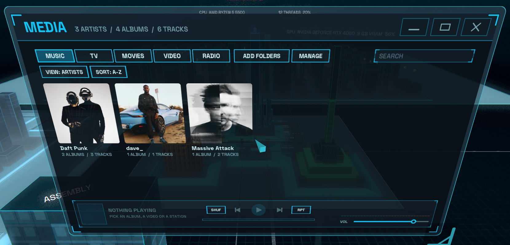
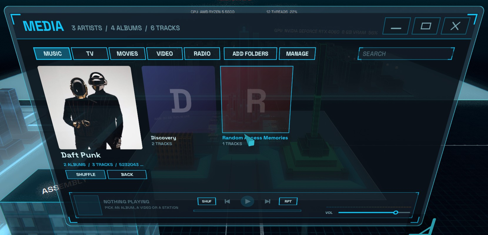
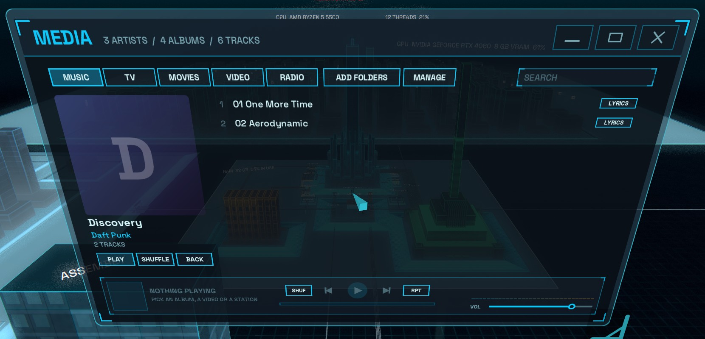
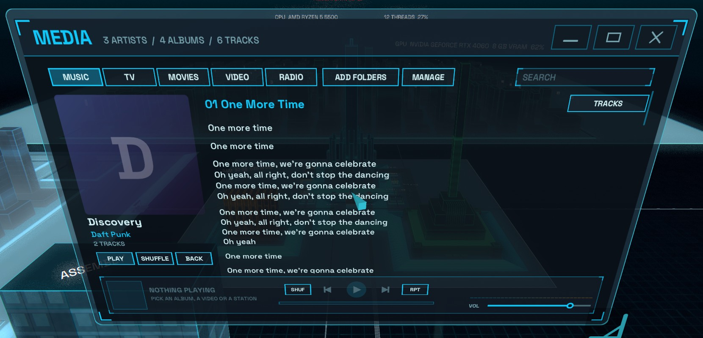

**TV** - shows are found from file names (`Show.S01E02.mkv`, `1x02`, or `Show\Season 1` folders) and shown as poster
cards with a progress strip. Open one for its season view, which starts on the season you were last watching, with a
thumbnail, runtime, air date and summary for each episode. `CONTINUE` / `RESUME` picks up where you left off, and each
episode can be marked watched or unwatched.
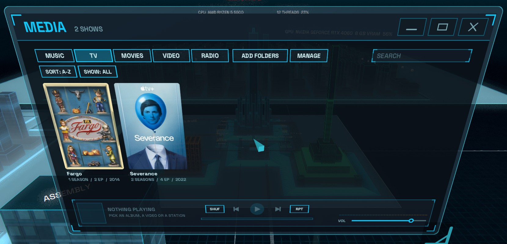
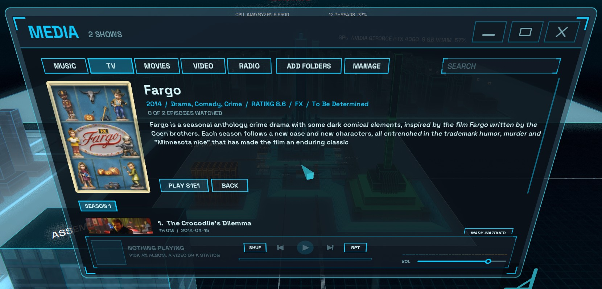

**Movies** - poster cards from files named like `Movie Name (1999).mp4` or kept in a `Movies` folder. The movie page
shows the poster, year, genre, runtime, director, writers, cast, a full intro and the storyline (combined from IMDb,
iTunes and Wikipedia), and resumes where you stopped. Scraped info is cached in the library database, and a progress
bar shows while new items are still being fetched.
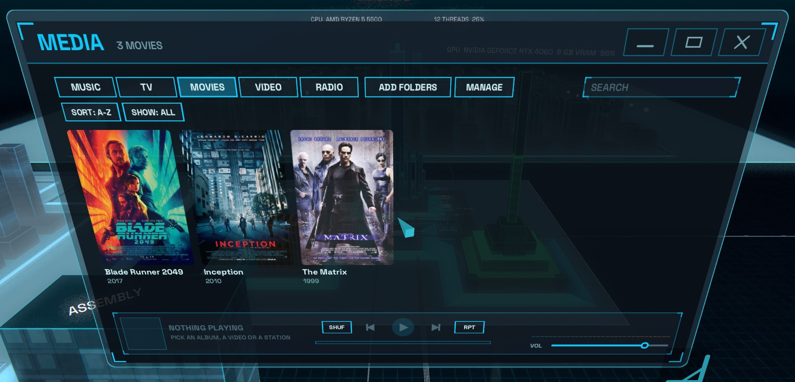
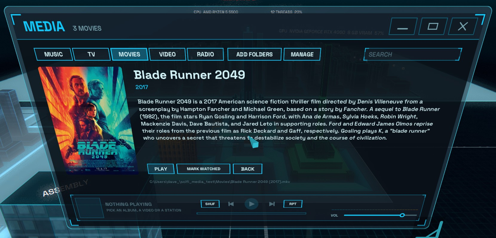

**Search and filter** - the search box matches titles, artists, albums and genres. TV and movies also have `SORT` (A-Z,
recently watched, year, rating) and `SHOW` (all, in progress, unwatched, watched).

**Library database** - everything the player works out is kept in `%LOCALAPPDATA%\SciFiShell\media\media.db`
(SQLite): scraped info, episode lists, posters (cached in `media\img`), durations, and your watch progress. Info is
fetched in the background from free public sources (TVmaze, iTunes, Deezer, Wikipedia and lrclib) and never blocks
the window. If you are offline the saved info is used and anything missing is fetched later.
Embedded track tags are saved in the same database and cover art and video thumbnails in `media\cache`, so the
library opens instantly and identically on later runs (delete `media\cache` to refresh covers).

**Video** - play a video right inside the window. `FULLSCREEN` takes the picture to the full size of your display: only
the video is shown, and the title, seek bar, transport and volume fade in when you move the pointer and fade away again
a couple of seconds later. Click the picture to pause, `Esc` to leave. Frames are scaled on the decoder thread to the size
they are shown at, so HD video stays smooth.
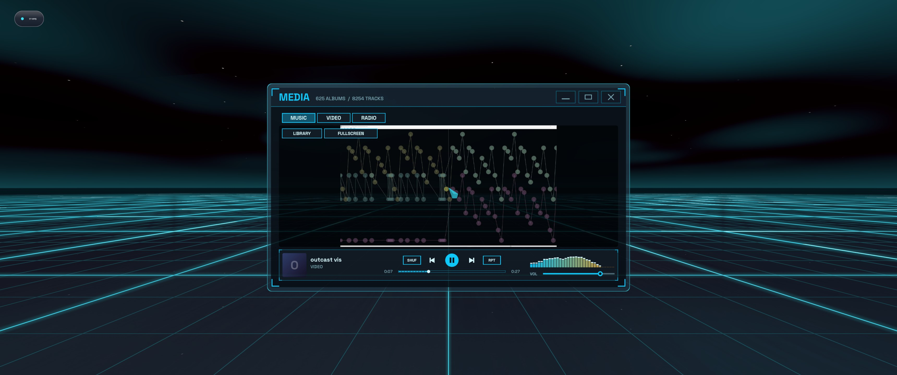
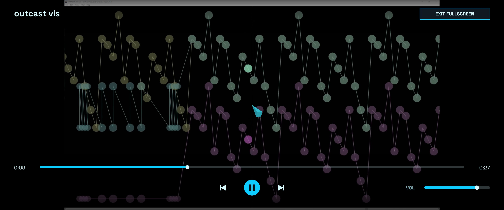

**Radio** - a set of hand-picked live stations, one click to play. Add your own by putting `Name|URL|Genre` lines in
`radio.txt`.
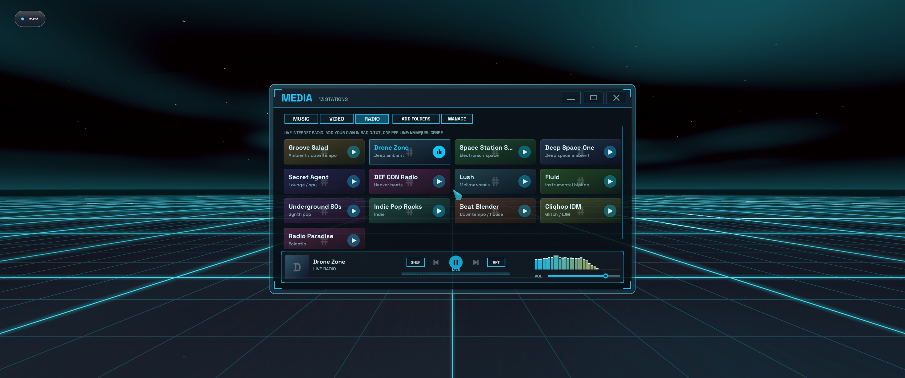

- **Adding folders:** `ADD FOLDERS` opens the Windows folder picker (select several at once), or just drop a folder
  onto the window.
- **Removing folders:** `MANAGE` lists every watched folder with a `REMOVE` button next to each; `DONE` goes back.
- **Keyboard seeking:** with the media window focused and search unfocused, left and right arrows seek backward or forward
  ten seconds on a short press. Hold either arrow to scrub at 10x speed until released. Live radio cannot be seeked.
- **Keyboard playback:** with the media window focused and search unfocused, up and down adjust volume by 10%, and
  space toggles play/pause, including for live radio.
- **Background playback:** close the window and the music keeps playing. While something is playing, **Media** always
  appears in the `Alt+Tab` switcher so you can glide straight back to it.
