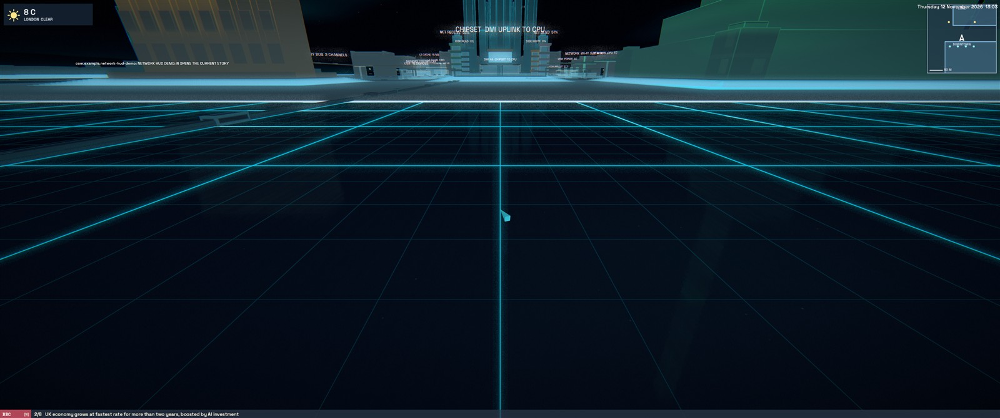
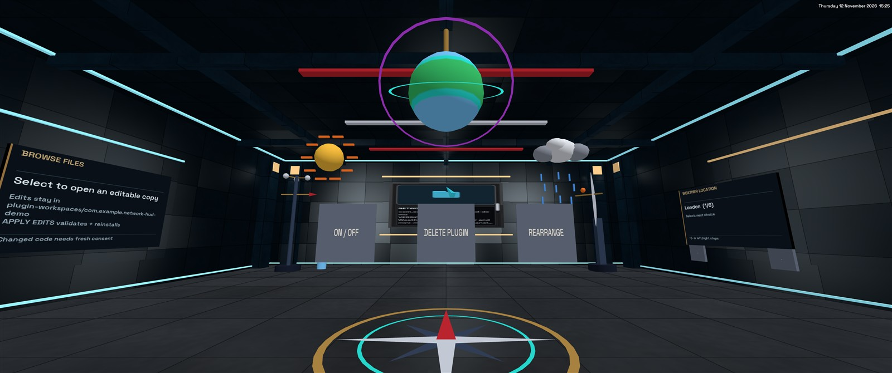
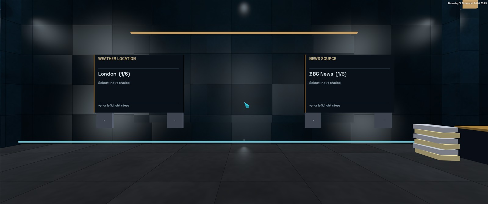
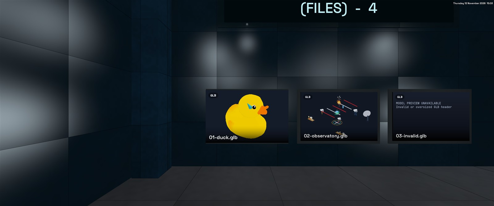

# Plugins

This guide targets the **SciFi Shell v0.9.29 Windows x64 installer**. Other released or unreleased builds may behave differently. The experimental gameplay API can change; there is no stability or compatibility guarantee.

## Bundled plugins and updates

v0.9.29 installs these packages **disabled** on first encounter in a profile:

| Plugin | Version | Notes |
|---|---|---|
| TRACKFLY 2 | 2.2.1 | Exact author-approved package by Davidalanfisk; G/Start near the launch pad enters flight. |
| [Bug Hunter](../examples/plugins/bug-hunter) | 0.1.1 | Original procedural cyan wireframe roaches, infinite-ammo laser rifle and saved score/kills. G/Start equips; Escape/Y exits. |
| [Network HUD Demo](../tests/fixtures/network-hud-demo) | 1.1.2 | Weather/news/map HUD and observatory; six location presets, BBC/NPR/NASA sources; Windows network transport. |

Use **Settings > Plugins** to enable and approve a package. Bundling does not grant consent,
execute Lua, request network data, acquire controls or create gameplay HUD/audio while disabled.
Existing same-ID packages, enabled preferences, consent, scores, settings and editable workspaces
are preserved on upgrade; the bundled version never overwrites a user's installed version.

One-time receipts in the profile's `SciFiShell/plugin-defaults/<plugin-id>` directory survive
removal and host updates. Removed defaults stay removed, not silently restored every launch.
To reinstall or update explicitly, import a ZIP from the application's `assets/plugins` directory
or the release downloads. Existing same-ID packages must first be disabled/removed; back up
edits first. Uninstall preserves plugin storage (including Bug Hunter score/kills), but removes
the editable workspace and room settings. A changed package must be enabled/consented normally.
See the bundled [controls/provenance notes](../assets/plugins/README.txt).

## API 4: Bug Hunter services

The [Bug Hunter prototype](../examples/plugins/bug-hunter) requires **v0.9.29**, not v0.9.28.
Manifest `api_version` stays `"1"`; `capabilities().api` is `4`.
Version 0.1.1 fixes the city bounds field name (`max_x`), reported working by the user.
The host was compiled and the release payload inspected, but automated tests and app/visual
smoke checks for this release were deliberately not run at the user's request; authored
regressions are not a claim of passing tests or hardware/controller certification.

* With `scene`, `scene_material(handle, opacity, emission)` opts an owned box/model/mesh into an unlit,
  depth-tested translucent material. Opacity is 0–1, emission 0–4; nonfinite values are rejected.
  Zero opacity hides drawing, not ray picking. These objects do not write depth and sort far-to-near within their
  owner; intersecting objects/across-owner transparency is approximate. Normal existing objects are unchanged.
  Meshes can author explicit edge geometry for wireframes; there is no automatic triangle-wireframe flag.
* With `world`, `world_raycast(ox,oy,oz,dx,dy,dz,max_distance)` returns nearest collision distance or `nil`.
  Direction is normalized and must be nonzero with components in ±1.001; positions are bounded to ±10,000,
  range to 0–100 metres. Uses the city's collision hulls plus ground plane, not mesh triangles, file paths,
  other plugins or every native toy/track decoration. Raised bus decks use thin hulls rather than filling the
  space underneath. Pad slopes are conservative box approximations. Unavailable/over-budget queries fail
  explicitly. Maximum four rays per callback, sharing the existing 64 world/view query budget; source traversal
  is rejected above 4,096 city containers/towers or 32,768 generated collision hulls.
* An active desktop `control` lease receives `on_input("aim",0/1)` for right-button held state and
  `on_input("mouse_wheel",notches)` for wheel impulses clamped to ±8. These never go to unowned plugins or UI,
  have no wheel replay after focus/capture reset, and release aim when ownership ends. Right-click does not
  also pin a host window while the lease is owned.
* `control_zoom(factor)` requires an active `control` lease; finite factors 1–8 narrow the desktop world's
  projection by that tangent ratio. UI/HUD coordinates stay unchanged; VR projection is never altered.
  Zoom resets to 1 on lease release, failure, disable, context loss or stop.
* `control_exit_button("y")` opts a `control` plugin into Xbox Y instead of the default B exit.
  `"b"` restores the default. Start/View, Escape/G and controller-disconnect exits remain host-owned.
  The selected pad exit is consumed before script/native UI actions; existing plugins retain B behavior.

## v0.9.28 changelog

v0.9.28 adds approved-host HTTPS text, crisp graphical HUD panels, plugin rooms/settings, a read-only city map,
safe hotkey browser links and in-shell plugin editing. It also recognizes Lua source in file previews/the editor
and adds static GLB geometry thumbnails. These additions are experimental; `capabilities().api` is `3`.
The manifest's `api_version` remains the string `"1"`; it is not the capability-discovery version.



The [Network HUD Demo 1.1.2](https://github.com/Davidalanfisk/SciFiShell/releases/download/v0.9.28/NetworkHudDemo-1.1.2.zip)
was a separate download in v0.9.28; v0.9.29 includes it installed disabled. Its [editable source and original room generator](../tests/fixtures/network-hud-demo)
are included in the repository and the release source ZIP. Review the listed permissions/hosts before enabling.
Weather locations are six preset public cities, not automatic geolocation or arbitrary locality input.

To rebuild the demo, run `python tests\fixtures\network-hud-demo\generate-room.py`, then ZIP only
`plugin.json`, `scripts/main.lua` and `assets/room.glb` at those exact root-relative archive paths, using `/`
inside ZIP entry names. Do not include a wrapper directory or the generator in the installable ZIP.
The [source ZIP](https://github.com/Davidalanfisk/SciFiShell/releases/download/v0.9.28/NetworkHudDemo-1.1.2-source.zip)
also includes the generator and is for editing, not installation.

**Network text (Windows only).** Request `"network"` and declare the exact hosts in a new `"network_hosts"` manifest array; both are required together. The consent prompt lists every declared host (`..., HTTPS TEXT FROM api.example.com, news.example.org`). Grants are stored against the package digest, so changing the host list requires consent again. This deliberately least-privilege default (declared and approved HTTPS hosts only, no wildcards) may be revisited.

* `network_hosts` has 1–4 entries. Each entry is a lowercase public DNS name of at most 63 characters, with at most 100 characters in total. The following are rejected:
  * IP addresses and `localhost`
  * `.local`, `.internal`, `.arpa`, `.lan` and `.home` names
  * wildcards, ports and schemes
  * duplicates

  The 4-host, 100-character total is a **temporary consent-screen bound**, not a network or security need. It keeps the complete host list visible in the fixed-size consent notice, so hosts are never truncated or hidden from the user. A manifest over the bound is rejected at install with an error; it is not shortened. The notice switches to a compact font when the hosts need it, which is tested for every permission combination with the widest glyphs. Raising the bound needs a scrollable consent screen first.
* `net_get(url)` queues an HTTPS GET to a declared host and returns a request ID.
  * The URL must be `https://` and must not contain user information, a non-443 port or a fragment.
  * An invalid or undeclared URL raises an error.
  * When the plugin has 4 requests pending, or exceeds the rate limit (a burst of 4, then one per 5 seconds), `net_get` returns `nil, message` instead.
* `net_cancel(id)` returns whether a pending request was cancelled. It aborts the transfer if one has started, including a DNS lookup in progress, and `on_network` is never called for that ID. `net_pending()` returns the pending count.
* Results arrive later on the application thread as `on_network(id, ok, status, text)`. On failure, `text` is a short `network: ...` reason.
* Only text is returned:
  * Accepted content types are `text/*`, JSON, XML, RSS and Atom.
  * Bodies are limited to 1 MiB, uncompressed (`Accept-Encoding: identity`).
  * Text is decoded from UTF-8 or ISO-8859-1. NUL and control characters other than tab and newlines are rejected.
  * Nothing is rendered or executed.
* Transport policy: TLS 1.2 or later, with normal certificate and host-name validation.
  * There are no cookies, credentials, authentication, proxy or redirects: a 3xx response fails.
  * Timeouts are 5 seconds each for resolve, connect and send, 10 seconds for receive, and 15 seconds in total.
  * At most 4 transfers run concurrently and 32 are queued across all plugins.
* **Address pinning.** Each request goes through a single-use, in-process loopback CONNECT tunnel:
  * The tunnel resolves the declared host itself. It refuses the host if *any* answer is loopback, private, link-local, CGNAT, multicast, documentation, benchmarking, cloud-metadata or otherwise reserved. This rejects IPv4-mapped, NAT64, Teredo and 6to4 IPv6 forms; only global unicast `2000::/3` outside documentation ranges is allowed.
  * It connects only to an address it has just validated, so private endpoints never receive a TCP connection, TLS handshake or HTTP bytes. There is no gap between check and connect for DNS rebinding to exploit.
  * TLS remains end to end between WinHTTP and the server, using the declared name for SNI and certificate checks.
  * IP literals and `localhost`, which WinHTTP would connect to directly, are refused before WinHTTP sees them.
* Disabling, failing, uninstalling or revoking a plugin aborts its in-flight transfers. No result is delivered after cancellation.
* Other platforms report `network: unavailable on this platform`; they do not fall back to an unprotected transport.
* `json_decode(text)` returns Lua values, or `nil, message`. JSON `null` becomes `nil`. Limits: 1.5 MiB of input, depth 32 and 200,000 values.
* `feed_items(text[, max])` turns RSS or Atom into plain-text items with `title`, `link`, `summary` and `published`. It returns at most `max` items (1–50, default 50). Markup, CDATA tags, scripts and entities are converted to text; it is not an HTML renderer.

**Graphical HUD panels (`hud` permission).** Plugins can place up to four of their own panels anywhere in the file-room/city view (where `hud_set` messages also appear).

* `hud_panel(anchor, x, y, w, h[, canvas_w, canvas_h])` returns a panel ID from 1 to 4.
  * `anchor` is one of `top_left`, `top`, `top_right`, `left`, `center`, `right`, `bottom_left`, `bottom` or `bottom_right`.
  * `x` and `y` are offsets from the anchor in fractions of the window (−1..1). `w` and `h` are fractions from 0.02 to 1.
  * The logical drawing canvas defaults to the panel's share of 1280×720. Each logical side is 16–4096 units, with at most 1 megapixel of logical canvas across all of a plugin's panels. The wider side allows a single-line news strip without increasing the total allowance. Existing drawing coordinates do not change with display resolution.
  * The host rasterizes shapes and font glyphs directly at the panel's actual display-pixel density, rebuilding on window/panel resize or DPI changes. In VR it also accounts for the projected size in each eye. Physical rasters are bounded to 4096 pixels per side, 8× the logical scale, 4 MiPixels per running HUD plugin and 16 MiPixels globally (64 MiB of RGBA textures). When necessary the global allowance is shared equally and raster density is reduced, never the panel's on-screen size. Hidden panels release their textures. The shared font glyph cache is bounded to 16 MiB.
  * The canvas is stretched to fill the panel. The panel size is a fraction of the window, so its aspect ratio follows the window (a circle becomes an ellipse in an ultrawide window). Use `hud_view()` to size proportionally and rebuild only when its dimensions change.
* `hud_panel_move(id, anchor, x, y, w, h)`, `hud_panel_visible(id, visible)` and `hud_panel_remove(id)` manage a panel.
* `hud_clear(id[, r, g, b[, a]])` clears a panel's drawing and sets its background colour; the default is transparent.
* Drawing commands use canvas pixels, with colours in 0..1:
  * `hud_rect(id, x, y, w, h, r, g, b[, a[, radius]])` fills a rectangle given by its corner and size.
  * `hud_frame(id, x, y, w, h, thickness, r, g, b[, a])` outlines a rectangle given by its corner and size.
  * `hud_line(id, x0, y0, x1, y1, thickness, r, g, b[, a])` draws between two points.
  * `hud_circle(id, x, y, radius, r, g, b[, a])`
  * `hud_text(id, x, y, text, size[, r, g, b[, a[, align]]])` with text of at most 256 printable UTF-8 bytes, size 8–128 and `align` of `left`, `center` or `right`.
* Each panel holds at most 512 commands and 16 KiB of text, and coordinates must be within ±4096.
* The host rasterizes changed panels at most 10 times per second; unchanged panels do not trigger uploads. Resize/DPI redraws may coalesce for up to 0.1 seconds. Moving, hiding or removing panels still applies immediately.
* Panels are clamped on screen and form a HUD layer above app windows, fullscreen media/apps, ordinary Settings, menus and the on-screen keyboard, on both desktop and VR render paths. Built-in HUD readouts and the pointer remain above plugin panels.
* **Consent safety exception:** while a gameplay permission-confirmation prompt is open, plugin panels and `hud_set` labels are temporarily suppressed so another plugin cannot obscure the requested permissions. They reappear after the prompt is closed, approved or expires.
* Panels are display-only: they never receive clicks or keyboard focus, and clicks pass through to the world and shell as before.
* In VR, panels share one fixed head-locked area instead of the full window.
* Stopping, failing, disabling or uninstalling a plugin removes its panels and their GPU resources.
* `hud_set(text)` now accepts 64 characters (previously 32).

The deterministic [`HUD QUALITY REVIEW` fixture](../tests/fixtures/hud-quality-review) provides fixed text and an overlapping center panel for comparing raster sharpness and window layering without any network requests.

**Minimal example: network JSON to a HUD panel.** This complete plugin shows the current temperature for a fixed public location. It sends no credentials and no user location. A fuller review sample, with an RSS ticker and a placement pattern, is in [`tests/fixtures/network-hud-demo`](../tests/fixtures/network-hud-demo).

`plugin.json`:

```json
{"id":"com.example.weather-panel","name":"WEATHER PANEL","version":"1.0.0","author":"Example",
 "description":"Current London temperature","entry":"scripts/main.lua","type":"gameplay",
 "platforms":["any"],"permissions":["scene","hud","network"],"network_hosts":["api.open-meteo.com"],
 "api_version":"1"}
```

`scripts/main.lua`:

```lua
local URL = "https://api.open-meteo.com/v1/forecast?latitude=51.51&longitude=-0.13&current=temperature_2m"
local panel, request

local function show(text)
    hud_clear(panel, 0, 0, 0.1, 0.8)
    hud_frame(panel, 1, 1, 318, 78, 2, 1, 0.6, 0.1)
    hud_text(panel, 12, 24, text, 26, 1, 1, 1)
end

return {
    on_start = function()
        panel = hud_panel("top_right", -0.02, 0.03, 0.25, 0.11, 320, 80)
        request = net_get(URL)
        show("LONDON  ...")
    end,
    on_network = function(id, ok, status, text)
        if id ~= request then return end
        if not ok then return show(string.sub(text, 1, 30)) end
        local data, err = json_decode(text)
        local t = data and data.current and data.current.temperature_2m
        show(t and string.format("LONDON  %.1f C", t) or ("BAD DATA " .. tostring(err)))
    end,
}
```

Zip `plugin.json` and `scripts/main.lua` at the archive root and install the zip with **Settings > Plugins > Install Package**. Then select the plugin twice to approve the consent notice, which lists `HTTPS TEXT FROM api.open-meteo.com`.

**Discovery and errors.** `capabilities()` returns a table with each granted permission set to `true`, plus `api = 3` (api 3 adds the host services described in [Plugin rooms, settings, links and the mini-map](#plugin-rooms-settings-links-and-the-mini-map)). Calling a function without its permission now raises an error that names the missing permission, for example `view_pose requires the 'view' permission in plugin.json`.

**Lua runtime.** Gameplay scripts get a safe subset of the standard library:
* **Base library:** without `load`, `dofile`, `loadfile`, `require`, metatable or raw access, `collectgarbage`, `print`, `warn` or `xpcall`.
* **`string`:** without pattern functions, `dump` or `pack`; `find` is plain text only.
* **Also available:** `table`, `utf8` and `math`.

The instruction budget cannot be caught by `pcall`.

**Larger limits** (other limits unchanged):

| Limit | Before | Now |
|---|---|---|
| Gameplay Lua memory above the compiled baseline | 1 MiB | 16 MiB |
| Message-script Lua memory | 1 MiB | 1 MiB (unchanged) |
| `hud_set` length | 32 characters | 64 characters |
| Persistent storage keys | 64 | 256 |
| Persistent storage string value | 1,024 bytes | 16,384 bytes |
| Persistent storage file | 64 KiB | 256 KiB |

The 16 MiB Lua limit is sized for four pending 1 MiB results plus decoded JSON. Retaining more fails with a clean memory error that stops the plugin.

The following are intentionally unchanged because they are resource or security bounds rather than file-size restrictions:
* the 1 GiB package, 100 MiB asset and 10 MiB text limits
* the 16 MiB decoded-asset budget
* GPU, GLB and PNG limits
* the 128-object scene limit
* the 100,000-instruction budget

**Not yet provided** (recommendations for later):
* local time zone and daylight-saving time
* mouse wheel input
* interactive or focusable panels
* POST and other non-GET requests
* binary downloads
* proxies
* networking outside Windows

## Plugin rooms, settings, links and the mini-map

These host services ship in v0.9.28 (`capabilities().api == 3`). The host owns every control: plugins declare what they need in `plugin.json`, the consent notice lists it, and the player changes values inside the plugin's room. The [network HUD demo](../tests/fixtures/network-hud-demo) uses all of them: a weather card, a news ticker, a mini-map and an original "observatory" room model.

**Manifest fields** (all optional):

| Field | Format | Bounds |
|---|---|---|
| `settings` | `"key\|LABEL\|value=Label,value=Label"` | up to 4 settings with 2–8 choices each; lowercase keys and values |
| `hotkeys` | `"n=action_name"` | up to 4; letters `h i j k m n o p q r t u x y z` only (movement and shell keys stay reserved) |
| `link_hosts` | HTTPS host names, same rules as `network_hosts` | up to 4 hosts, 100 characters in total |
| `room_model` | `"assets/<name>.glb"` | must exist in the package; same GLB limits as other models; fitted to the room |
| `"map"` permission | in `permissions` | enables the read-only map functions |

The host-count limits keep the consent notice readable. They are a temporary UI bound, not a network-safety limit, and the host list is never silently truncated: invalid lists are rejected at install.

**Settings.** `setting(key)` returns the current value (the first choice until the player changes it). Values persist per plugin in the profile and are removed on uninstall. When the player presses − or + on a settings console in the plugin room, the host stores the new value and calls `on_setting(key, value)`. A setting never widens permissions: a news-source selector can only choose among hosts already declared and approved. Settings are fixed choice lists; there is no free-text input. The sample's weather location is therefore one of six preset public cities, not an arbitrary locality. Settings are saved by atomically replacing the file, so a failed save keeps the previous choice and the console shows "NOT SAVED".

**Hotkeys and links.** A declared hotkey calls `on_action(name)` on a fresh key press in the focused desktop city world, not inside rooms or in VR. It is not sent while text input, Settings, menus, consent notices, a control lease or another app has focus. If several plugins bind the same letter, each receives it. Only inside `on_action`, a plugin may call `open_link(url)` once. The URL must be HTTPS on a declared `link_hosts` entry, without credentials or a non-443 port. It opens in the built-in browser; plugins can never launch an external browser or command. Host approval applies to the requested navigation, not to the subsequent browsing session: the browser can display normal site content, cookie prompts and page navigation. Its behavior is distinct from the credential-free, no-redirect `net_get` transport. Non-CEF source builds report that the built-in browser is unavailable instead of launching an external one.

**Text and view.** `text_width(text, px)` returns the rendered width in canvas units (text ≤256 bytes, 8–128 px). `hud_view()` returns the HUD's logical width and height, or `nil, reason`. `hud_scroll(panel, speed, view_width)` turns a panel into a clipped marquee. The panel's canvas scrolls horizontally at `speed` units per second (0–2000), showing `view_width` units at a time. This makes a single-line ticker that only scrolls when its text is wider than the strip.

**Mini-map** (`map` permission). All functions are read-only and limited to 16 calls per callback:

* `map_view()` returns `{x, z, heading, min_x, min_z, max_x, max_z}`. Heading is in degrees clockwise from north (−Z). Outside the city (interiors, VR rooms, startup) it returns `nil, reason` rather than invented coordinates.
* `map_regions()` returns up to 64 districts `{id, name, kind, x, z, width, depth}`: core, downtown, settings and anonymous storage blocks.
* `map_pois()` returns up to 128 entries `{id, name, kind, x, z}` for CPU/RAM/GPU towers, plugin buildings and Settings buildings.

IDs are stable across sessions. Names are display names only. No file system paths, user names or drive labels are exposed.

**Plugin rooms.** Every gameplay plugin's building now has a larger, more detailed exterior. Its interior has a solid floor, corner pilasters and a coffered ceiling. Rooms without a custom model also have a runner, lit central dais and overhead light ring. Custom-model rooms omit those central decorations so authored floor inlays remain visible; the solid floor's upper surface is at model height `y=0`. The room contains:

* ON/OFF, DELETE and REARRANGE cards
* up to four settings consoles
* a **BROWSE FILES** console
* an **APPLY EDITS** console

`room_model` places the plugin's own model in the room.





**Editing a plugin from inside the shell.**
1. **BROWSE FILES** extracts the installed ZIP once into an editable workspace and opens it in the built-in file browser. The workspace is at `%LOCALAPPDATA%\SciFiShell\plugin-workspaces\<id>` (`~/.config/scifishell/plugin-workspaces/<id>` elsewhere). Extraction reuses the strict package reader, so there is no traversal and no unexpected names, and the installed ZIP is not modified. Later browses keep your edits.
2. Edit `plugin.json`, `scripts/main.lua` or `assets/` with the built-in editor.
3. **APPLY EDITS** (select twice within 15 seconds) packs the workspace into a new ZIP. The confirmation is bound to the exact packed contents: if the files change between the two selections, the second selection asks for confirmation again instead of installing the newer files. Links, junctions, unexpected files and over-limit files are refused. The ZIP is validated as a gameplay package with the same id. The host then:
   * disables the plugin and revokes its consent
   * replaces the installed ZIP, keeping a backup and rolling back if registration fails
   * leaves the plugin disabled

   Edited code never runs under the old grant. Enabling it shows the consent notice again, because the package digest changed.
4. Uninstalling removes the workspace and the plugin's settings.

Native bundled plugins (Car and Track, Parks and Toys, Neon Circuit Arcade) have no editable package. Theme and script packages are not editable in-shell either. Their BROWSE FILES consoles say so instead of opening anything.

**Lua source and model previews.** `.lua` files (including mixed-case extensions) open as source in the built-in
File Editor, with keyword/string/comment highlighting and normal save support; opening a source file never executes it.
File Room text thumbnails read the first 4 KiB. Files larger than 10 MiB and binary files remain read only.
GLB file tiles now show real static, depth-tested geometry with embedded base-colour texture where supported.
They load lazily on the background thumbnail worker and use the existing path/size/mtime cache. This is not an
interactive model viewer. Previews accept at most 8 MiB and the same narrow GLB subset described below; unsupported,
invalid or over-budget models show an explicit error. See the [developer resource bounds](development.md#notes--limitations).


## v0.9.27 changelog

Scripted player/camera control now permits **1000 units/second**, up from 25, while retaining
0.25-unit collision substeps, a 0.1-second host tick cap, 4-radian/second angular limits and
the existing finite-pose, world, permission, focus and explicit-activation checks.
This is not a native vehicle-speed change. Scripts hardcoding the old speed must update their
own motion/chase-camera pacing; upgrading the host alone does not speed them up.

The [input contract](#controller-input) now includes Left Shift `boost`, Xbox Start acquisition
and Start/Back/B release with exclusive controller routing, held-state cleanup/resynchronization,
and active-owner-only `mouse_yaw` / `mouse_pitch` relative angular impulses. Mouse impulses are
consumed once, not multiplied by dt or treated as held axes. No new manifest permission or
API-version value is required; the older v0.9.26 host does not supply these new controls.

### TrackFly 2.2.1 example (v0.9.27)

Download [TrackFly2-2.2.1.zip](https://github.com/Davidalanfisk/SciFiShell/releases/download/v0.9.27/TrackFly2-2.2.1.zip)
from the release, separately from the installer. This is the exact reviewed package by
**Davidalanfisk**, supplied by its author and published with their approval; its asset bytes
and authorship are preserved. No additional asset licence or public-domain status is asserted.
It was a separate optional download in v0.9.27; v0.9.29 bundles it installed disabled, without replacing existing user packages.
The manifest's review-host wording refers to the controls now released in **v0.9.27**.

Use **Settings > Plugins > Install Package**, select the ZIP without extracting it, then select
**TRACKFLY 2** twice within 30 seconds to review and grant the requested permissions.
If the same ID is already installed, back up your profile first and use the normal disable/remove
flow before installing the new package; import does not overwrite existing packages, and removal
can remove saved data. The ID remains `com.davidalanfisk.trackfly2`; score-key naming is unchanged.
Wait for its city survey, approach the launch pad within four units, and press **G / Xbox Start**.
Keep the world focused with panels closed. **Escape/G/Start/B/View-Back** releases flight.

| Action | Keyboard / mouse | Xbox |
|---|---|---|
| Yaw | Mouse left/right; A/D adds yaw | Left stick X |
| Pitch | Mouse up/down, following shell sensitivity/invert-Y | Right stick Y |
| Throttle / brake-reverse | W/S | Left stick Y or RT/LT |
| Strafe | No separate key | Right stick X or D-pad left/right |
| Climb / descend | Space / Left Ctrl | Y/X or D-pad up/down |
| Boost | Hold Left Shift or left mouse | Hold A or RB |
| Full brake (overrides boost/throttle) | S brakes/reverses | Hold LB |

Boost sources are independent; releasing one does not cancel another held source.
Boost can launch from rest, with about 3.6 seconds of energy and 7.1 seconds to recharge.
The cruise/boost targets are 300/800 units/second, with smoothed acceleration and a combined
800-unit velocity ceiling. The package paces camera corrections below 900 units/second and
combined rotation below 3.8 radians/second; excess mouse motion is discarded, not backlogged.
Only plugin-generated fake ground shadows were removed, not global renderer shadows.

The in-flight HUD starts with **actual camera/player speed** in shell units/second (not km/h),
measured from the last accepted view-position displacement and callback dt, then compact course/time
guidance. It updates about four times/second, resets on acquisition and reads zero for a blocked
camera; craft speed can differ because of camera lag and collision.
The plugin caps physics steps at 66 ms, so very low frame rates slow flight rather than enlarging
steps. Host collision is still player-sized city collision, not full swept vehicle-body physics;
the plugin also performs its own bounded craft sweep. City bounds and geometry can constrain travel.
This is not an unlimited-world, FPS, physical-controller or VR-flight certification.

## v0.9.25 changelog

Default Downtown buildings use the standard city door face/trim and a north-facing door at
`(plot.x,0,plot.z-6.1)` (2.72 units wide, 3.4 high). The default-building exit remains
`(plot.x,1.7,plot.z-12)`. Optional custom exteriors retain the separate host frame at `plot.z-9`;
their model schema and validation limits are unchanged.

A separate Settings quarter north of Computer is host-owned, not a plugin privilege. Its buildings
are generated from the existing Settings taxonomy and use the exact menu callbacks, values,
slider limits and confirmations. No package can replace these rooms, disable a settings group or
acquire new filesystem/rendering/OS permissions through the district. Existing city collision and
track-clearance queries account for both districts.

Settings buildings and galleries use the enlarged scale (64-unit plot pitch), while Downtown
keeps its existing scale and saved placements. Settings rooms use dark, color-correct live consoles,
eye-height controls and the existing permission/destructive confirmation surfaces.
All package manifest fields, `downtown_model` limits and gameplay API permissions remain unchanged.

## Neon Circuit Arcade (v0.9.26)

**NEON CIRCUIT ARCADE** (`org.scifishell.arcade`) is a bundled
precompiled C++ native plugin, not a Lua package.
Visit through **Settings > Downtown > Visit Neon Circuit Arcade**, or its cyan/magenta-trimmed
building south of Computer. Twelve cabinets occupy three rows. The back half is covered by a
furnished office/bedroom mezzanine; the front has a double-height ceiling. The stairs start at
the right front corner, turn left at the landing, and open into the upstairs railing.
Walk into stairs normally; jumping/flying is unnecessary. The entry wall has Exit, On / Off
and Rearrange controls. Escape/Back exits the room when no cabinet is selected.
The upper stair ends at a level landing with a guarded opening onto the full-width loft.
Disabled/failed plugins retain the ordinary host management room and cannot be uninstalled.

Aim at a cabinet screen and click, press Enter / gamepad A, or use the VR controller ray and
trigger. Selection opens that cabinet's menu and seats the desktop view at the screen.
Choose Play, Game, Difficulty (1-3), Invert Y or Browse for NES ROM. Use arrows, mouse wheel,
D-pad, left stick or VR left stick to select a row; left/right changes its value, and
Enter/click/A/VR trigger activates it. Configuration is independent for every cabinet.
Escape/gamepad B/Back/VR Back stops the game and returns to the cabinet menu; a second
press releases the cabinet and restores the previous viewpoint. The shell's other hotkeys,
camera movement and controller shortcuts are suppressed while a cabinet owns input.
F12 and the app-close action remain available.

| Original game | Play |
|---|---|
| Pulse Rally | Move paddle with W/S, arrows, mouse up/down, gamepad left stick or VR left stick. Outlast the opposite paddle. |
| Orbit Breaker | A/D or left/right stick rotates; W or stick up thrusts; Space/mouse button/gamepad A or right trigger/VR trigger fires. Clear the drifting vector rocks. |
| Sky Rescue | WASD/arrows or left stick moves. Fire as above; Shift/gamepad X/VR left grip rescues when close to the ground. |
| River Runner | Tap/release a direction (arrows/WASD/D-pad/stick) to hop. Avoid traffic, stay on river platforms and reach the far bank. |

These are independently authored mechanics/graphics, not ports or replicas of commercial games.
Inactive cabinets run only a procedural attract painter at 8 Hz: there are no background game
sessions, emulator pages, ROM loads or audio voices. One cabinet may run at a time; original
games use a fixed 60 Hz simulation, and NES uses one isolated CEF surface. Leaving a cabinet,
focus loss, leaving/rebuilding the district, disabling the plugin or shutting down stops its
session and owned sounds. Focus loss ends rather than suspends a run. Native effects and NES
audio follow the shell SFX volume.

Preferences and original-game best scores reuse the bounded atomic storage format
(256 entries / 256 KiB maximum in v0.9.28; previously 64 entries / 64 KiB) in `%LOCALAPPDATA%\SciFiShell\arcade\builtin.arcade.store`
on Windows. Scores are saved at game over and when a run ends. Imported ROMs are copied to fixed
`cabinet-0.nes` through `cabinet-11.nes` names in that same private profile directory, never
into the application or installation assets. At most twelve 1 MiB imports can be retained.
Corrupt preferences are preserved and reported as a failed plugin start; failed writes are
shown on the cabinet, not reported as saved. Back up or repair a corrupt file before retrying.
Native code is trusted, not an OS sandbox, and multiple writers to one profile are unsupported.

### NES import and limits

The Windows CEF build bundles **JSNES 2.1.0**, Apache-2.0, with its licence in
`assets\arcade\JSNES-LICENSE.txt`. No commercial ROMs, BIOS files, artwork or music are included
or fetched. Select an idle cabinet, choose **Browse for NES ROM**, select a local `.nes` file
in the Windows file picker, and then choose **Play**. You can also drop exactly one local
`.nes` file onto the shell while the cabinet menu is open. Cancelling leaves the cabinet unchanged.
The picker starts at the Windows system drive root.
Only use material you are entitled to run. The file is bounded to 1 MiB, must have an exact
iNES or supported NES 2.0 header and payload, mapper 0, 16/32 KiB PRG and 0/8 KiB CHR.
NES 2.0 is limited to NTSC/multiregion NROM, no PRG RAM, standard controllers, no extra ROMs
or submapper, and 8 KiB volatile CHR RAM when no CHR ROM is present. Its compatible header is
adapted only in memory for JSNES; the original and imported file remain unchanged. Trainers,
battery saves, PAL/Dendy-only NES 2.0, other mappers, archives, links and mismatched/trailing data are rejected
with a visible error. This deliberately does **not** claim all NES games work. Non-CEF builds
report that NES requires CEF while retaining the four native games.

NES directions use WASD/arrows, D-pad or left sticks. A is Space/mouse/gamepad A/right
trigger/VR trigger; B is Shift/gamepad X/VR left grip. Start is Enter/gamepad Start/VR menu,
and Select is Tab/gamepad LB/VR right grip. Back always releases emulator input instead of
being sent to the game. There is no save-state, battery-save, ROM browser, arbitrary URL,
download button or JavaScript filesystem bridge. Importing requires an explicit selection or drop,
not a directory scan. The native picker is available on Windows; other builds use drag and drop.
The Windows picker appears on the desktop monitor, including when using VR.

The host verifies the pinned engine SHA-256 before execution and passes only validated bytes
as base64 to an ephemeral `about:blank` surface. Its separate request context has no disk cache;
navigation, subresources, network requests and popups are denied. Frame/startup errors are
reported on the cabinet. Closing mutes/hides and closes that page; the next cabinet never
inherits its input or audio. These restrictions are in-process safeguards, not an OS sandbox.

**Not implemented:** MAME-compatible emulation/engine fetching, other console engines,
save states, two-player games, arbitrary control remapping, and pinball. MAME as a whole
is GPL-2.0-or-later with mixed component licences; a pinned compatible browser distribution,
its source/compliance materials, driver/ROM requirements and resource limits still need
validation before integration. No placeholder fetch button pretends that this work is done.
Pinball remains on the [wishlist](todo.md#arcade-wishlist).
Physical headset/controller comfort, audio listening and broad ROM compatibility need
manual review; simulated input checks are not hardware certification.

## v0.9.24 changelog

Downtown now fits its occupied plots instead of reserving all 128 possible plots. The floor, outline,
label, storage packing, bus avoidance and track clearance use the same dynamic bounds.
The connector road to Computer has been removed. The bundled Car and Track and Parks and Toys
now have default buildings, host management rooms and persistent rearrangement alongside packages.
Their existing on/off controls work even when disabled; built-in plugins cannot be uninstalled.
Existing package placements and optional `downtown_model` schema remain compatible.

## v0.9.23 changelog

Downtown gives every installed package a stable physical building south of Computer, surrounded by
a theme-colored glass-region outline matching the district's full reserved bounds. Host-owned entrances,
management rooms, safe evacuation, persisted plot moves/swaps, and the optional gameplay manifest
field `downtown_model` are new in this release. Existing packages need no changes and receive a default
building; disabled and failed plugins keep their entrances. Existing source/archive/runtime limits and
digest-bound consent and removal-confirmation checks are retained. The model field is optional but requires v0.9.23.

## Downtown district (v0.9.24)

Downtown is a host-owned district **south of Computer** (+Z in city coordinates). Every installed
theme, message-script or gameplay package gets a building, including disabled or failed packages.
The bundled native **Car and Track** (`org.scifishell.driving`) and **Parks and Toys**
(`org.scifishell.parks`) also receive stable plots and default buildings. They use the same Visit,
Arrange and On / Off controls; their removal card is disabled and labeled **BUILT-IN - CANNOT DELETE**.
Buildings represent
installed packages, not running Lua scene objects; disabling a plugin does not remove its management
entrance. Uninstalling removes it.

Walk south from Computer or use **Settings > Downtown > Visit [name]**. Aim at the standard door
(or the separate illuminated host frame for a custom exterior) from within 12 units and click/select.
Every entrance leads to a host-managed, empty
room with package ID, name, version, description and status, an **On / Off** control, **Delete Plugin**,
**Rearrange**, and an exit. Escape/Back also exits. No package filesystem is exposed in this room.
The host retains these controls even if plugin code fails.

Toggling or deleting from inside first moves you safely outside and opens Plugins. Enabling gameplay
uses the same digest-bound permission notice as Settings: select the plugin again within 30 seconds
to consent. Dismiss the panel to cancel without enabling. Delete arms the ordinary Remove confirmation:
select **Remove [name]** again within 15 seconds to confirm, or let that deadline expire to cancel. A failed operation
reports its error and leaves the remaining package/building accessible; removal may already have disabled
the package or revoked consent. Re-enable through the normal permission flow if removal failed.

To rearrange, select **Arrange [name]** in Downtown (or the room's Rearrange card), choose
**Previous Plot / Next Plot**, then **Move / Swap**. The target card names the current occupant;
occupied destinations swap both buildings, empty destinations move only the selected building.
Rearrangement returns a city visitor to the district gateway before changing geometry.
Numbered plots use a four-column, 32-unit-pitch layout starting at `(x=-48,z=128)`.
There are 128 selectable plots for the existing 64-package installation limit plus the two bundled
plugins. The district is the bounding rectangle of occupied plot centers with a 20-unit margin on
each side; a completely empty district uses a minimal 32x40 footprint south of Computer.
The colored floor/outline and label, drive packing, bus avoidance and native/scripted track clearance
all use these same bounds. Installing or removing a plugin grows/shrinks the region without renumbering
existing buildings. Intentionally selecting a distant plot includes the gaps in the outline.
Resizing repacks storage regions and regenerates bus/track geometry, first releasing player control,
leaving the car/data-lane ride and returning city visitors to the safe gateway. Nearby storage regions
may therefore move; occupied plugin plots do not. The track may pass overhead with clearance.
There is currently no connector road between Computer and Downtown.

Arrangements are saved atomically to `%LOCALAPPDATA%\SciFiShell\downtown.ini` on Windows
(alongside `plugins.ini` on other platforms), keyed by package ID. New packages take the lowest free
plot; uninstall releases only its plot. Disable/re-enable, failures, city rebuilds and restarts retain
placements. Corrupt preferences are preserved and reported; buildings use a deterministic read-only
recovery layout until the preferences are repaired. Write failures are reported, not presented as saved
moves. Lifecycle changes still reconcile the live city. As with other plugin preferences, concurrent
writers from multiple shell instances are not supported.

### Optional exterior model

Gameplay ZIP manifests may add one optional string, without changing `api_version`:

```json
"downtown_model": "assets/garage.glb"
```

Include that exact file in the existing package asset table. It must pass the normal restricted GLB
decoder (including rejection of external resources) and package/archive/decoded limits, **plus**
8,192 vertices, 8,192 triangles and an embedded texture no larger than 256x256.
The model's baked scene bounds are uniformly scaled to fit a 12x12x12 box, horizontally centered on
the plot and grounded at y=0. Existing scene-node transforms and embedded material/texture are retained.
The host uses a conservative solid box for collision, not triangle or doorway collision.
The entrance is always a separate host frame at `(plot.x,0,plot.z-9)`; exit is at
`(plot.x,1.7,plot.z-12)`. Do not depend on a model doorway, interior geometry, Lua startup, or enabled
state for entry. Custom exteriors currently use the same host room as default buildings.

The exterior is uploaded through bounded, host-owned GPU resources during registration, independently
of script consent or execution. It stays visible when the plugin is off/failed. Renderer budget/allocation
failure is logged and shown on the package's Arrange card and uses the default building rather than
losing management access. Uninstall releases its exterior GPU resources. Theme and message-script
packages have no asset table and always use the procedural host-default building. Missing or invalid
declared models reject installation; omitting the field preserves all existing package behavior.
No new Lua functions, arbitrary filesystem loading, remote downloads, custom interiors or marketplace
are introduced. This manifest field is not accepted by v0.9.22 and earlier installers.

## v0.9.22 changelog

Plugin Lua source, gameplay/script `plugin.json`, and theme `.sfplugin` files now accept **10 MiB (10,485,760 bytes) each**, inclusively, instead of 16 KiB. Message-script ZIPs now allow **20 MiB + 64 KiB (21,037,056 bytes)** on disk so both files fit even without compression. The shell's read-only code viewer also reads up to 10 MiB instead of 2 MiB; its rendered-line cap remains 4,000 characters. Gameplay ZIP disk/expanded totals remain 1 GiB and encoded binary assets remain 100 MiB.

Lua compilation now has a **128 MiB allocation ceiling** per state. After compilation, compiler scratch is collected and the loaded code/constants establish a fixed baseline; the chunk and callbacks share at most **1 MiB of additional Lua allocations above that baseline**, never exceeding 128 MiB total. The 100,000-instruction budget for the chunk and each callback is unchanged. A source within the file cap can still fail explicitly if its compiled representation exceeds the compilation ceiling, Lua syntax limits, or execution budgets. Compilation and package validation are synchronous and can pause the shell.

Manifest schemas and field-length limits are unchanged: the larger file allowance permits formatting, not arbitrary extra metadata or 10 MiB field values. Names remain at most 40 printable ASCII characters, authors 80, descriptions 160, IDs 80, and versions 24. Decoded/GPU memory, archive-entry/metadata, storage, messaging, voice and other behavior/resource limits are unchanged. Installer staging excludes test executables and test-only native fixtures; Windows shared-SDL builds copy the required SDL2 runtime alongside the shell.

## Alpha gameplay API additions

The following APIs are available in v0.9.21, **not in the v0.9.20 installer**. They remain experimental; share the required shell version with plugin users.

### Gameplay package limits

Gameplay ZIP files may be at most **1 GiB (1,073,741,824 bytes)** on disk and their entries may total at most **1 GiB uncompressed**. Each uncompressed binary asset may be at most **100 MiB (104,857,600 bytes)**; `plugin.json` and `scripts/main.lua` may each be at most **10 MiB (10,485,760 bytes)**. The 34-entry limit remains. Installed ZIP files share a 4 GiB disk quota when installing either a gameplay or script package; do not install concurrently from multiple shell processes. ZIP metadata is also bounded. Assets are read one at a time rather than unpacked to disk, but loading a large asset still temporarily uses memory proportional to its encoded size. Installation, approval and startup read and validate packages synchronously, so large files can pause the shell. Decoded assets share a separate 16 MiB per-package budget, and each format has additional geometry, dimension, or duration limits. GLB parsing has an 8 MiB allocator budget, separate from the encoded-file cap. The internal in-memory archive interface remains capped at 8 MiB on disk and expanded, so it cannot load a 10 MiB source; Settings installation, consent and startup use the file-backed path and accept the full text limit.

The allowed asset extensions now include `.wav` and `.ogg` as well as `.png` and `.glb`. Nested paths such as `assets/ships/fighter.glb` are supported: the portion after `assets/` is at most 80 characters, lowercase ASCII letters, digits, `_`, `-`, `.`, and `/`. Components cannot be empty or begin with `.`, and `..` is forbidden. Include files only: directory entries, links, duplicate paths, backslashes, and traversal are rejected. Existing consent records remain valid for unchanged packages; newer consent records store a SHA-256 digest and size instead of another copy of the ZIP. Packages changed after approval require new consent. These checks do not protect against a hostile process running as the same user.

These additions are a framework, not the HARVI, FlyTrack, arcade, apartments, garages, ownership or other game content. Multiplayer, shared worlds, voice chat, server authority and remote asset downloads are not provided. v0.9.28 adds declared-host HTTPS text and graphical HUD panels; see [the changelog](#v0928-changelog). There is no widget toolkit or dedicated plugin debug-log API; read-only map metadata is described above.

### Persistent storage

Add `"storage"` to a gameplay manifest's `permissions`; users must explicitly grant it. It exposes `storage_get(key)` (value or `nil` if absent), `storage_exists(key)` (boolean), `storage_set(key,value)`, and `storage_delete(key)` (deleting a missing key succeeds). Values are strings, finite numbers or booleans. Keys are 1-64 printable ASCII characters; strings may contain arbitrary bytes and are limited to 16,384 bytes (1,024 in v0.9.27 and earlier). There are at most 256 keys and 262,144 bytes of serialized data per plugin (previously 64 keys and 65,536 bytes). Errors, invalid arguments and quota violations stop the callback/plugin rather than silently discarding writes.

Writes are synchronous and persisted immediately: at most 8 may burst, replenishing 4 per second, with at most 64 storage calls per callback. Avoid writes every frame. Storage survives disable, restart, package replacement, and uninstall; it is not automatically deleted. On Windows files live in `%LOCALAPPDATA%\SciFiShell\plugin-storage`, named by plugin ID. This is not secret storage, encrypted storage, an OS sandbox, or a coordination mechanism for simultaneous shell processes; avoid sensitive data and concurrent writers. Corrupt or unreadable files stop startup and are not overwritten. Other plugins cannot address the store using this API, but native code or other processes running as the same user have normal filesystem access.

The [storage demo ZIP](https://github.com/Davidalanfisk/SciFiShell/releases/download/v0.9.21/storage-demo.zip) increments a stored count on each start and shows it on the HUD. Its source is in [`examples/plugins/storage-demo`](../examples/plugins/storage-demo). From the repository root, package it without directory entries:

```powershell
python -c "import zipfile,pathlib; p=pathlib.Path('examples/plugins/storage-demo'); z=zipfile.ZipFile('storage-demo.zip','w',zipfile.ZIP_DEFLATED); [z.write(p/n,n) for n in ('plugin.json','scripts/main.lua')]; z.close()"
```

### Controller input

Gameplay manifests may request `"controller"` together with `"input"`. Consent lists controller input separately. `on_input(control,value)` receives `gamepad_left_x`, `gamepad_left_y`, `gamepad_right_x`, `gamepad_right_y`, `left_trigger`, `right_trigger`, `button_a`, `button_b`, `button_x`, `button_y`, `button_start`, `button_back`, `dpad_up`, `dpad_down`, `dpad_left`, and `dpad_right`. For compatibility each change is also delivered first under its legacy `pad_lx`, `pad_ly`, `pad_rx`, `pad_ry`, `pad_lt`, `pad_rt`, `pad_a`, `pad_b`, `pad_x`, `pad_y`, `pad_start`, `pad_back`, `pad_up`, `pad_down`, `pad_left`, or `pad_right` name respectively. Handle only one naming family to avoid acting twice. `pad_connected`, `pad_lb`, `pad_rb`, `pad_ls`, and `pad_rs` have no new alias. Sticks are dead-zoned in `[-1,1]`, Y is positive up, triggers are in `[0,1]`, and buttons and availability use 0/1. Only changes are delivered; leaving the available interaction context or disconnecting resets held values to zero. On Windows this uses the first XInput controller; elsewhere it uses the first SDL game controller. VR controller events are not included.

Controller input is shared with the shell unless the plugin holds the existing `control` lease. In shared mode shell shortcuts may act on a button first or open a panel, preventing that press from reaching the plugin; for example X opens the keyboard and Y opens Start. A nearby offer from a controller-enabled plugin displays **G / Start: Enter**. A fresh Xbox **Start** press activates it using the same focus, consent, proximity and world-context gates as G; connecting a pad or regaining focus with Start held does not activate it. While it owns control, **Start**, **Back/View** or **B** releases it, as do Escape/G and controller disconnection. These three buttons are reserved by the host while owned, not delivered as script actions. Other pad axes/buttons go to the plugin, without shell keyboard/ring/window-switcher shortcuts. After exit or context loss, held pad controls must return to neutral before controlling the shell again. Input remains unavailable when interacting with panels, typing, driving natively, or in VR.

With `input`, Left Shift also produces `on_input("boost",1)` when held and
`on_input("boost",0)` on release or unavailable interaction context. It is independent of
controller buttons; combine it with your chosen pad boost action in the script.
On activation the host resets the keyboard/controller change snapshots so currently held values are
resent after `on_input("control",1)`. Before `control=0`, previously delivered axes, buttons, click
and boost receive zero/release values. Scripts should still clear their local input state on release
or disconnect and must not propose poses before activation. In shared mode the existing input
permission still allows remote controls when no lease is held.

With `input` and an **active control lease**, captured flat-screen mouse movement produces
`on_input("mouse_yaw",delta)` and `on_input("mouse_pitch",delta)` before `on_tick`.
These are relative **radian impulses**, not held axes: positive yaw turns right (subtract from
camera yaw), positive pitch looks down (subtract from pitch). Shell look sensitivity and invert-Y
are already applied at 0.0025 radians/pixel before sensitivity scaling. Accumulate and consume
them once per tick; **do not multiply by dt**. Identical nonzero deltas repeat on consecutive
frames; zero deltas generate no callback. Each axis is clamped to `4*dt` radians with no backlog
and at most two mouse callbacks per frame; scripts must still clamp their combined
mouse/keyboard/controller rotation to the pose limits. Nonfinite deltas are discarded.
No mouse input is delivered to unowned plugins or while UI, focus, capture or VR makes world
input unavailable. Acquisition and capture/context recovery frames discard relative motion;
it is never resent with held-state snapshots. Clear pending impulses on `control=0`.
The native camera does not also rotate while a plugin owns control.

### Packaged samples

With the required `"scene"` and existing `"sound"` permissions, package `.wav` or `.ogg` files under `assets/`. `asset_sound("sounds/tone.ogg")` returns a package-local sound asset handle; `sound_play_asset(sound)` starts it at full volume and returns a distinct voice handle. Use `sound_loop(voice)` to enable looping and `sound_stop(voice)` to stop it. A voice that has already finished cannot be made to loop. Alternatively, `sound_sample("assets/sounds/tone.ogg", 0.5, true)` starts the named sample with a 0-1 volume and a required loop boolean, returning a voice handle. Voices stop automatically when the plugin stops or fails. Calls enqueue actions for the next host frame; the existing sound event rate limit also applies to sample actions. Calling `sound_loop` on a newly queued voice combines it with the start action.

Samples must be mono or stereo, 8-48 kHz, and at most 30 seconds; WAV must be uncompressed 16-bit PCM, and OGG must contain Vorbis audio. Audio is mixed to mono and resampled for the effects device. There are at most four sample voices per plugin and 16 globally, with at most eight queued sample actions per frame. Decoded samples share the 16 MiB per-package decoded-asset budget with textures and models. Invalid samples and exceeded limits fail explicitly.

The [audio demo ZIP](https://github.com/Davidalanfisk/SciFiShell/releases/download/v0.9.21/audio-demo.zip) starts an original looping tone and relies on automatic cleanup. Its source is in [`examples/plugins/audio-demo`](../examples/plugins/audio-demo). From the repository root:

```powershell
python -c "import zipfile,pathlib; p=pathlib.Path('examples/plugins/audio-demo'); z=zipfile.ZipFile('audio-demo.zip','w',zipfile.ZIP_DEFLATED); [z.write(p/n,n) for n in ('plugin.json','scripts/main.lua','assets/tone.ogg')]; z.close()"
```

### Time and randomness

`time_now()` returns monotonic seconds from an unspecified origin; `time_since_start()` and its alias `time_elapsed()` return monotonic seconds since this plugin session started. `time_frame()` is the current host frame number, shared by plugins; `time_delta()` is the latest clamped tick delta in seconds, initially zero. `time_unix()` returns whole seconds since the Unix epoch; it uses the system clock and can jump if the clock changes. No additional permission is needed.

`random()` returns a number in `[0,1)` and `random_range(min,max)` returns a finite real between finite ordered bounds. `random_seed(number)` resets this plugin session's generator to a deterministic sequence; the seed must be finite. The Lua `math.random` and `math.randomseed` generator remains available separately. Neither generator is suitable for security or secrets.

### Inter-plugin messages

Request `"messaging"` to send local events with `send_event(eventName, data)` and register a handler with `on_event(eventName, callback)`, whose callback receives `data`. Payloads are finite numbers, booleans, or strings of at most 256 bytes. Event names are 1-32 lowercase ASCII letters, digits, `.`, `_` or `-`; up to 32 names can be registered, and registering a name again replaces its callback. The existing `message_emit(topic, payload)` remains string-only, and `on_message(sender, topic, payload)` receives all events, including typed ones. If both handlers are present, `on_message` runs first, followed by the matching `on_event` callback, each with a separate instruction budget. Messages are broadcast to other currently running plugins that also have this permission, not to the sender. They are delivered on a later frame, with the sender's plugin ID supplied to `on_message` by the host. A message from a plugin that stops before delivery is discarded. Delivery is not durable, private, or networked; do not send secrets or rely on messages for authority.

```lua
-- Sender (messaging permission): send_event("race_complete", elapsed_seconds)
-- Receiver also requests hud.
on_event("race_complete", function(seconds)
    hud_set("RACE COMPLETE")
end)
return {}
```

Each plugin can queue at most eight outgoing messages before the host drains them, with a burst of four and four messages per second thereafter. The shared pending queue is capped at 64; exceeding a limit stops the sending plugin. Callback errors stop the receiving plugin.

### Asset discovery

With the required `"scene"` permission, `asset_exists(path)` checks a full packaged path, and `asset_list()` returns an alphabetically sorted array of all packaged asset paths. `asset_find(pattern)` returns sorted full paths; patterns may start with `assets/` or be relative to it. `*` matches zero or more characters within one path component and `?` matches one; neither crosses `/`. For example, `asset_find("ships/*.glb")` finds `assets/ships/fighter.glb` but not `assets/ships/sub/fighter.glb`. Patterns without wildcards retain the earlier prefix-matching behavior; an omitted or empty pattern lists all assets. These functions do not access arbitrary files or directories. Use `asset_model`, `asset_texture`, `asset_sound`, or `sound_sample` to use the returned assets.

### Procedural meshes

`mesh_create()` creates a mutable builder. `mesh_vertex(mesh,x,y,z)` appends a vertex and returns its one-based index. `mesh_normal(mesh,x,y,z)` and `mesh_uv(mesh,u,v)` set attributes on the latest vertex; defaults are `(0,0,1)` and `(0,0)`. `mesh_triangle(mesh,a,b,c)` appends a triangle of existing one-based indices. `mesh_upload(mesh)` finalizes the nonempty builder and returns the mesh handle; after upload it cannot be edited or uploaded again. `scene_mesh(mesh)` creates a white, untextured unit-sized instance at the origin. Actual GPU upload occurs when the renderer needs it.

Alternatively, `mesh_create(vertices, indices)` creates an immutable mesh directly. `vertices` is a flat array of eight numbers per vertex: position x/y/z, normal x/y/z, and UV u/v. `indices` is a flat array of one-based vertex indices, three per triangle. All values must be finite and within -10,000 to 10,000. Each plugin may create at most eight builders or meshes in total, each with at most 1,024 vertices and 6,144 indices.

Use `scene_mesh(handle, texture, x, y, z, width, height, depth, red, green, blue)` to instantiate it; use texture `0` for the default or a handle from `asset_texture`. It returns a scene object handle usable with the existing scene transform and removal functions. The mesh is uploaded when needed and remains immutable until the plugin stops; existing per-owner GPU limits apply. GPU and mesh resources are released on stop or failure.

## Start here

You do not need to build the shell to make a plugin: install [v0.9.27](https://github.com/Davidalanfisk/SciFiShell/releases/tag/v0.9.27), a text editor, and optionally Python 3 for the ZIP commands below. The installer is unsigned. Launch the **installed** shortcut rather than an older source build or taskbar pin.

| What you want | Package | Start with |
|---|---|---|
| Change two shell theme colours | One JSON `.sfplugin` file, no code | [Theme packages](#theme-packages) |
| Return a short message on demand | ZIP with a Lua message script; no permissions | [Clock example](#lua-plugin-authoring-specification) |
| Add experimental in-world objects and interactions | ZIP with Lua and optional GLB/PNG/WAV/OGG assets; explicit permissions and consent | [First gameplay plugin](#first-gameplay-plugin), then the [API reference](#experimental-gameplay-scripts) |

1. Open the Start menu with **F2** or middle-click, then **Settings > Plugins > Install Package**. Select the downloaded or locally built `.sfplugin` or `.zip`.
2. Select the installed plugin's name to enable it. Gameplay plugins show their ID and requested permissions: inspect these and select again within 30 seconds to consent. New packages are disabled until enabled. A retained preference for the same ID can change the initial state.
3. For the [clock ZIP](https://github.com/Davidalanfisk/SciFiShell/releases/download/v0.9.19/scifishell-clock-example.zip), select **Run CLOCK** after enabling it. For the [scripted car and track](https://github.com/Davidalanfisk/SciFiShell/releases/download/v0.9.20/scripted-car-track.zip) or [scripted parks and toys](https://github.com/Davidalanfisk/SciFiShell/releases/download/v0.9.20/scripted-parks-toys.zip), return to the city to try them. Disable the corresponding native features separately if they overlap.
4. To iterate, change your source, rebuild the ZIP, select **Remove** twice within 15 seconds to uninstall the old package, then install and enable the new ZIP. Installation does not overwrite existing packages; changed gameplay ZIP contents need fresh consent. Keep your source outside the installed plugin directory.

**Trust and privacy:** permissions restrict which host functions a gameplay script receives; they are not an OS security boundary. Lua and asset decoding execute in the shell process, and bugs in those components can compromise it. Only install and approve packages from people you trust, and review requested permissions and source. Gameplay plugins may request bounded persistent storage (not secret storage), approved-host HTTPS text and read-only city/player map data. There is no third-party native-code installation, general filesystem, arbitrary network, OS or module-loader API. Bundled native modules have the shell's full privileges.

## First gameplay plugin

This minimal example creates one box four units in front of the current view. Make a folder named `hello-plugin` with `plugin.json` and `scripts\main.lua` inside it. Save both as plain ASCII or UTF-8 **without a BOM**. Use a unique ID you control when sharing; do not use the reserved `org.scifishell.` prefix.

`plugin.json`:

```json
{
  "id": "com.example.hello",
  "name": "HELLO BOX",
  "version": "1.0.0",
  "author": "Example",
  "description": "Place a box in front of the view",
  "entry": "scripts/main.lua",
  "type": "gameplay",
  "platforms": ["any"],
  "permissions": ["scene", "view"],
  "api_version": "1"
}
```

`scripts\main.lua`:

```lua
local box

return {
    on_tick = function(dt)
        if not box then
            local x, y, z, dx, dy, dz = view_pose()
            if x then
                box = scene_box(x + dx * 4, y + dy * 4, z + dz * 4,
                                1, 1, 1, 0.2, 0.8, 1)
            end
        end
    end
}
```

From the directory **containing** `hello-plugin`, create a ZIP with Python 3 on Windows:

```powershell
python -c "import zipfile,pathlib; p=pathlib.Path('hello-plugin'); z=zipfile.ZipFile('hello-plugin.zip','w',zipfile.ZIP_DEFLATED); [z.write(p / n,n) for n in ('plugin.json','scripts/main.lua')]; z.close()"
```

Install `hello-plugin.zip`, consent to `scene` and `view`, and close Settings to look for the box. It is placed once, where the view was when the plugin started; it does not follow you and can be obscured by city geometry. Disable and re-enable to place it again. The script waits if the view is not yet available. Try changing the size or RGB values, then use the remove/reinstall workflow above. Use a new ID if the example ID is already installed.

The [gameplay duck source](../examples/plugins/gameplay-duck) adds animation and a packaged model; the [other examples](#experimental-gameplay-scripts) demonstrate interaction and world queries. For debugging, inspect Settings notices and the **PLUGIN STORAGE** / **PACKAGES** cards; a callback error stops the plugin. Ensure the ZIP has the exact root paths shown, the manifest has no extra fields, and requested functions have their corresponding permission.

## Bundled gameplay plugins

Settings > Plugins lists the built-in **Car and Track** and **Parks and Toys** plugins. Both are enabled by default; select either to disable or re-enable it immediately. Disabling driving exits the car and removes the track; disabling parks removes the parks, ducks, stands and active snacks. Preferences are stored separately from other settings in `%LOCALAPPDATA%\SciFiShell\plugins.ini` on Windows (`~/.config/scifishell/plugins.ini` elsewhere). If the preference file cannot be read or written, the page reports an error and does not overwrite the file.

The gameplay plugins use two trusted native modules built alongside the application. The driving module contains track generation, sampling and rendering, driving simulation and car rendering; the parks module contains scenery, ducks and toy simulation and rendering. Host-side integration and some interaction and scoring logic remain in the executable. The modules must be present next to the executable, are loaded only when their features are enabled, and are unloaded on disable. They run with the application's full privileges, **not in a sandbox**. They are bundled modules, not independently installable third-party packages; Settings does not install native code. Settings > Plugins also installs **data-only theme packages**: choose a `.sfplugin` file, then enable it on the Plugins page and cycle to it using Settings > Shell > Theme. Theme packages have no executable code, external files, network or filesystem permissions. Installed packages are discovered from the per-user `SciFiShell/plugins` directory at startup and start disabled unless previously enabled.

## Theme packages

A `.sfplugin` is one UTF-8/ASCII JSON file of at most 10 MiB, not a ZIP. All fields below are required; unknown fields, duplicate keys, permissions other than an empty array, and types other than `theme` are rejected. Strings use printable ASCII; `\"`, `\\` and `\/` are the supported escapes. IDs are lowercase reverse-domain-style letters, digits, dots and hyphens; `org.scifishell.*` is reserved. Colours are `#RRGGBB`.

An installable example is [`examples/plugins/twilight.sfplugin`](../examples/plugins/twilight.sfplugin).

```json
{"id":"com.example.twilight","name":"TWILIGHT","version":"1.0.0","author":"Example","description":"A violet theme","type":"theme","platforms":["any"],"permissions":[],"accent":"#aa22ff","alt":"#12ccdd"}
```

The shared `id`, `name`, `version`, `author` and `description` rules are in the [message-script manifest table](#lua-plugin-authoring-specification). `platforms` must be exactly `["any"]`; `permissions` must be `[]`; `accent` and `alt` are the two RGB colours. Install the file, enable it, then cycle to the theme in **Settings > Shell > Theme**. Not every built-in panel uses theme colours.

Installed packages start disabled unless a retained preference says otherwise. Installation never overwrites an existing package. Built-in plugins cannot be uninstalled. ZIP themes, arbitrary ZIP layouts, automatic package updates and an app store are not implemented. Gameplay plugins can request the bounded persistent storage described above; message scripts cannot.

## Lua plugin authoring specification

[Download the example clock plugin ZIP](https://github.com/Davidalanfisk/SciFiShell/releases/download/v0.9.19/scifishell-clock-example.zip); its [source files](../examples/plugins/clock) are included in this repository. It contributes a **Run CLOCK** card which displays the current Unix time. This section describes the message-script type; the separate, experimental gameplay type is described below.

A script ZIP must have these exact, case-sensitive root paths:

```text
plugin.json
scripts/main.lua
```

An empty `scripts/` directory entry is optional; no other entries are allowed. ZIP the **contents** of the example directory, not the containing directory. The archive is limited to 20 MiB + 64 KiB (21,037,056 bytes); each uncompressed file is limited to 10 MiB, and the script must not be empty. Duplicate paths, absolute paths, traversal, backslashes, symlinks, encryption, unsupported ZIP entries and corrupt CRCs are rejected. Archive paths are read into memory, never extracted to the filesystem.

The manifest must contain exactly the following fields; extra and duplicate keys are rejected:

```json
{
  "id": "com.example.clock",
  "name": "CLOCK",
  "version": "1.0.0",
  "author": "Example",
  "description": "Show the current Unix time",
  "entry": "scripts/main.lua",
  "type": "script",
  "platforms": ["any"],
  "permissions": [],
  "min_shell_version": "0.1.0"
}
```

| Field | Requirement |
|---|---|
| `id` | Unique, 3–80 ASCII characters, using lowercase letters, digits, `.` and `-`; at least one dot, no leading, trailing or consecutive dots. `org.scifishell.` is reserved. |
| `name` | Nonempty, at most 40 printable ASCII characters; labels the Settings cards. |
| `version` | Three dot-separated numeric components, at most 24 characters total, e.g. `1.0.0`. |
| `author` | Nonempty, at most 80 printable ASCII characters. |
| `description` | Nonempty, at most 160 printable ASCII characters. |
| `entry` | Exactly `scripts/main.lua`. |
| `type` | Exactly `script`. |
| `platforms` | Exactly `["any"]`. |
| `permissions` | Exactly `[]`; message scripts cannot request permissions. |
| `min_shell_version` | Exactly `0.1.0`; this is currently a fixed value, not a general version comparison. |

JSON strings accept printable ASCII only; `\"`, `\\` and `\/` are the only supported escapes. Fields are strings except for the two specified string arrays. Numbers, booleans, null and nested objects are not accepted. The Lua file is text-mode Lua 5.4 source. For example:

```lua
return "UNIX TIME: " .. unix_time()
```

The chunk must return a **string of 1–160 printable ASCII characters**; it may be truncated visually to fit the panel. `unix_time()` is the only supplied host function and returns the current Unix timestamp as an integer. Lua language operators, local variables, conditionals, loops and functions work subject to the budget, but **no standard libraries or base functions** are opened: for example `print`, `tostring`, `string`, `math`, `io`, `os`, `require`, `load` and `debug` are unavailable. Each execution starts a fresh state, with no persistence between runs. It is limited to 100,000 Lua VM instructions and 1 MiB of additional Lua allocations above the compiled-code baseline, with the separate 128 MiB compilation/total ceiling described in the [changelog](#v0922-changelog).

To package the example on Windows with Python, run this from the repository root:

```powershell
python -c "import zipfile; z=zipfile.ZipFile('clock.zip','w',zipfile.ZIP_DEFLATED); z.write('examples/plugins/clock/plugin.json','plugin.json'); z.write('examples/plugins/clock/scripts/main.lua','scripts/main.lua'); z.close()"
```

To install, open **Settings > Plugins > Install Package** and select the ZIP. Installation validates and copies it without overwriting an existing package. The input filename may be arbitrary; the installed copy is named `<id>.zip`. At most 64 installed theme, message-script and gameplay package files are supported in total. Select the plugin name to enable it: enabling executes the script once as validation, and failure does not persist the enabled state. Select **Run** to execute it again and display its message; no script runs continuously. Select the name again to disable. Select **Remove** twice within 15 seconds to uninstall; the shell disables the plugin and removes its package. A retained disabled preference means reinstalling the same ID stays disabled.

On startup the shell discovers packages in `%LOCALAPPDATA%\SciFiShell\plugins` on Windows (`~/.config/scifishell/plugins` elsewhere); saved enablement is in the adjacent `plugins.ini`. New IDs default to disabled. An enabled script is validated again on startup; errors leave it marked **ERROR** rather than running. The **PLUGIN STORAGE** and **PACKAGES** cards show preference and discovery errors, and Settings notices show install, enable, run and removal errors. Check manifest fields, paths and budgets first if a package fails. A malformed preferences file is not overwritten.

Lua runs in-process, not in an OS sandbox, and interpreter vulnerabilities remain possible. No filesystem, network, OS, input, native code, module loader or persistent data API is exposed to message scripts.

## Experimental gameplay scripts

Gameplay scripts are a separate package type and are **not yet equivalent to Car and Track or Parks and Toys**. Those features remain trusted bundled native modules. Gameplay scripts can create boxes, models and bounded procedural meshes, update them over time, register click targets, and optionally receive input, query city collision and cell occupancy, play sounds, display a short HUD message, apply a bounded player push and offer explicitly activated player/camera control. Storage and local events are available with consent, but do not provide authoritative shared scores or reproduce bundled gameplay. The API and limits are preliminary. The v0.9.19 clock download does not contain this functionality.

Download [scripted-car-track.zip](https://github.com/Davidalanfisk/SciFiShell/releases/download/v0.9.20/scripted-car-track.zip) and [scripted-parks-toys.zip](https://github.com/Davidalanfisk/SciFiShell/releases/download/v0.9.20/scripted-parks-toys.zip), or build them from this checkout with `python examples/plugins/build-gameplay-examples.py <empty-output-directory>`. Install them through Settings, then explicitly enable and consent to each. The second ZIP combines the nearby park and snack examples below; it uses the snack score as its HUD message. These examples are simplified, not replacements for the bundled native plugins. Disable the native plugins separately if you want to avoid overlapping features. The builder refuses to overwrite an existing example ZIP.

Scripted click targets consume their clicks before native shell actions, including while a claimed click is held, so that click does not also open an object behind it. Picking uses bounding boxes and does not check city occlusion: an interactive object behind a wall can still receive a click. A miss remains available to the shell.

An example is in [`examples/plugins/gameplay-duck`](../examples/plugins/gameplay-duck). To create its ZIP from the repository root, including the existing bundled Duck model:

```powershell
python -c "import zipfile; z=zipfile.ZipFile('gameplay-duck.zip','w',zipfile.ZIP_DEFLATED); z.write('examples/plugins/gameplay-duck/plugin.json','plugin.json'); z.write('examples/plugins/gameplay-duck/scripts/main.lua','scripts/main.lua'); z.write('assets/models/Duck.glb','assets/duck.glb'); z.close()"
```

[`examples/plugins/duck-throw`](../examples/plugins/duck-throw) demonstrates read-only view pose, a clickable launcher, city floor and collision queries, built-in sounds, a HUD counter and bounded, short-lived scripted projectiles. Create its ZIP with the same command, replacing `gameplay-duck` with `duck-throw` in the output filename and both source paths. It is an illustration, not a replacement for the bundled toys: it does not support pickup, explosions or scoring.

[`examples/plugins/park-cell`](../examples/plugins/park-cell) demonstrates finding up to three distinct vacant cells near the view, placing a small park and duck in each, and removing or relocating them as the city or view changes. Package it with the same command, replacing `gameplay-duck` with `park-cell` in the output filename and both source paths. It is not a replacement for the native city-wide parks and toys: its bounded nearby sample does not enumerate every city cell.

[`examples/plugins/snack-stand`](../examples/plugins/snack-stand) demonstrates two plugin-owned stands, ray picking, hotdog and ice cream pickup, bouncing projectiles, a temporary explosion and nearby player push, a wandering Duck model, plugin-local scoring and respawn. Create its ZIP with the gameplay-duck command, replacing `gameplay-duck` with `snack-stand` in the output filename and both source paths. It is not a replacement for the bundled toys: it spawns a single set of simplified objects near the view and does not interact with native ducks.

[`examples/plugins/car-track`](../examples/plugins/car-track) demonstrates a 32-segment terrain-sampled oval and a car using a packaged GLB body and PNG texture, with script-owned acceleration, steering, wheel motion, simple automatic oval-rail following, and city floor/collision queries. ZIP `plugin.json`, `scripts/main.lua`, `assets/car.glb`, and `assets/paint.png` at those exact paths; omit the generator script and directory entries. `generate-assets.py` recreates the two original example assets. Approach the car and press G to activate a bounded chase view; Escape or G releases it. Outside control mode WASD still moves the player and remotely drives the car. The fixed oval and simplified rail simulation do not replicate the native generated track or its physics; the car does not use CarConcept. Track heights are refreshed one sample every 0.25 seconds while the city is available; changes can take at least eight seconds to cover the oval. This is a driving API experiment, not a replacement for the native Car and Track.

To package it from the repository root:

```powershell
python -c "import zipfile,pathlib; p=pathlib.Path('examples/plugins/car-track'); z=zipfile.ZipFile('car-track.zip','w',zipfile.ZIP_DEFLATED); [z.write(p/n,n) for n in ('plugin.json','scripts/main.lua','assets/car.glb','assets/paint.png')]; z.close()"
```

Gameplay ZIPs must contain `plugin.json`, `scripts/main.lua`, and optionally assets under `assets/`. Supported extensions, nested path rules and current size limits are described in [gameplay package limits](#gameplay-package-limits). Duplicate, unexpected, absolute, traversal, backslash, link, encrypted, unsupported and corrupt entries are rejected. Assets are read without extracting archive paths to disk. The older v0.9.20 release allows only flat GLB/PNG assets and caps gameplay ZIPs at 8 MiB and each asset at 2 MiB.

The required manifest fields are `id`, `name`, `version`, `author`, `description`, `entry`, `type`, `platforms`, `permissions` and `api_version`. Optional fields are `downtown_model`, `room_model`, `settings`, `hotkeys`, `link_hosts` and `network_hosts`; unknown fields are rejected. The first five required fields follow the message-script rules above. Set `entry` to `scripts/main.lua`, `type` to `gameplay`, `platforms` to `["any"]` and `api_version` to the **string** `"1"`. `permissions` must contain `scene`, and may additionally contain `world`, `layout`, `input`, `view`, `sound`, `hud`, `impulse`, `control`, `storage`, `controller`, `messaging`, `network` and `map`; duplicates and unknown permissions are rejected. `layout` and `impulse` also require `world`; `control` requires `world`, `input` and `view`; `controller` requires `input`. `scene` allows visible objects, `world` permits city floor and collision queries, `layout` reveals city cell positions and occupancy, `view` reads the user's in-world camera position and direction, `sound` plays built-in effects and packaged samples, `hud` displays text and graphical panels, `impulse` applies bounded player pushes, `control` offers player/camera control, `storage` persists bounded plugin data, `messaging` broadcasts local plugin events, and `input` provides movement axes and exclusive click routing while interacting with the world, not while typing or interacting with UI. `controller` permits the controller events described above. `map` exposes read-only city/player map data, not private file paths. The host does not expose typed text. `network` additionally requires `network_hosts`, accepted only together with it; see [the v0.9.28 changelog](#v0928-changelog).

Install through **Settings > Plugins > Install Package**. New packages start disabled. Selecting a gameplay plugin without a matching grant displays its ID and requested permissions; select it again within 30 seconds to consent and enable it. Consent is stored against the exact ZIP contents, so changed contents require consent again. Disabling releases its objects and GPU resources but retains consent for re-enabling; uninstall revokes consent. Use **Disable** to stop a failed plugin, or select its name to retry. An enabled plugin can restart automatically if its unchanged package still has consent. Callback errors stop the plugin and are reported in Settings and stderr. Do not approve packages you do not trust: Lua and image/model decoders run in the shell process, not an OS sandbox.

The script chunk returns a table with optional `on_start()`, `on_tick(dt)`, `on_input(control, value)` and `on_stop()` functions. The host calls `on_start` when enabling, `on_tick` each frame, `on_input` for permitted input changes and relative mouse impulses, and `on_stop` when stopping normally. v0.9.28 also supports `on_network(id, ok, status, text)`, `on_setting(key, value)` and `on_action(name)` for the services above. State in local variables persists while the plugin runs, but a restart creates a fresh Lua state. The chunk and each callback have a 100,000-instruction budget; each plugin has 16 MiB (1 MiB in v0.9.27) of additional Lua allocations above its compiled-code baseline, with a 128 MiB compilation/total ceiling. `dt` is seconds, capped by the host at 0.1 per frame. v0.9.28 opens `math` and the restricted base/`string`/`table`/`utf8` subset described above, plus `json_decode`, `feed_items` and `capabilities`. There is no filesystem, module loader, code loading or operating-system API, and no network access beyond the declared-host `network` permission. Callbacks run on the application thread; exceeding the budget or raising an error stops the plugin and releases its scene.

* `scene_box(x,y,z,width,height,depth,r,g,b)` and `scene_model(model,texture,x,y,z,width,height,depth,r,g,b)` return owned integer handles. Texture `0` uses the GLB's embedded texture or white; otherwise use `asset_texture(path)`. `asset_model(path)` and `asset_texture(path)` return a package-local numeric asset ID or raise an error for an unknown path.
* `scene_move(handle,x,y,z)`, `scene_rotate(handle,x,y,z)` (radians), `scene_resize(handle,width,height,depth)`, `scene_colour(handle,r,g,b)` and `scene_remove(handle)` update owned objects. Coordinates are world-space, with Y vertical; box positions are their centres. Positions and rotations must be finite and at most 10,000 in magnitude, sizes must be in `(0,1000]`, and colour components in `[0,1]`. Up to 128 boxes and model instances combined are allowed.
* `scene_hit(handle,ox,oy,oz,dx,dy,dz,maxDistance)` tests a ray against the object's transformed unit box and returns the entry distance in world units, or nil on a miss. The origin must be finite within ±10,000, each direction component must be finite in `[-1.001,1.001]` and the nonzero direction is normalized; distance must be in `[0,100]`. A ray starting inside returns zero. This is a box approximation for models, not a triangle, city-occlusion or cross-plugin query. Unknown or removed handles fail the callback. It does not consume click input or affect shell interaction.
* With `world`, `world_available()` reports whether the city is active and built. `world_floor(x,y,z,radius,eyeHeight)` returns a city floor height; `world_resolve(x,y,z,radius,eyeHeight)` returns a collision-adjusted position. They fail when the city is unavailable; radii and eye heights must be between 0 and 100.
* With `world`, `world_track_clearance(x,z,radius)` returns the maximum height of native track-generation obstacle footprints intersecting the square from `(x-radius,z-radius)` to `(x+radius,z+radius)`, or zero if none intersects. It uses monuments, platforms and current/target tower dimensions, matching the native generator's obstacle inputs; it is **not** a complete city collision or bridge-clearance query. Coordinates must be finite within ±10,000 and radius between 0 and 100. It fails if the city is unavailable, the data is invalid, or the combined traversal exceeds 4,096 monuments, platforms, blocks and towers. It shares the 64-call callback budget. City geometry can change, so callers must resample.
* With `layout` and `world`, `city_cell(x,z)` returns `centerX, floorY, centerZ, pitch, occupied` for the grown city grid cell containing the point, or nil outside a cell. It reveals positions and occupancy, not names or paths. It fails when the city is unavailable or a query exceeds 4,096 examined platforms, 4,096 examined blocks or 4,096 towers in the selected block. City layout and occupancy may change; scripts must recheck and remove or relocate their objects. It does not enumerate every cell or reserve one, and multiple plugins may select the same cell.
* With `view`, `view_pose()` returns `x,y,z,dx,dy,dz` for the in-world camera or VR headset; it returns nil before entering the file room. Direction is the view direction, not a VR controller pointer. This is read-only and available while panels are open. At most 64 scene-hit, world, layout and view calls combined are allowed per callback.
* With `input`, `on_input` receives `move_x`, `move_y`, `move_z` axis changes in `[-1,1]`, Left Shift `boost` changes in `0/1`, and routed `click` press/release values `1`/`0`. An active lease owner also receives `mouse_yaw` / `mouse_pitch` radian impulses under the [relative mouse contract](#controller-input); these are not held axes. With `scene` and `input`, `scene_interactive(handle,true)` makes an owned object a click target; `false` removes it. The host chooses the nearest target within 14 units, breaking equal-distance ties by plugin ID, and consumes the click before native shell actions; misses go to the shell instead. Removing an object removes its target. `scene_hit` alone does not register one. With an active control lease, clicks go to its owner instead. A plugin can call `input_capture_clicks(true)` in a routed click press to capture later world clicks (for example while holding an item), then call `input_capture_clicks(false)` when finished. Capture cannot start without a routed press, never overrides UI or unavailable input, and is cleared on disable, failure or uninstall. The host resets held input when interaction becomes unavailable, including UI focus, native driving, VR and focus loss. Picking uses approximate object boxes, does not account for city occlusion, and targets behind walls can receive clicks. For controller events, also request `controller` as described above; VR controller input is not exposed.
* With `sound`, `sound_play(name, volume)` queues one built-in effect: `pickup`, `throw`, `boom`, `duck_pop`, `car_summon` or `rail_on`. Volume must be finite and in `[0,1]`, and the shell's sound volume applies. At most eight events can be queued before the host processes them; the host permits a burst of four and replenishes four per second per plugin. Exceeding either limit, lacking an audio device or exhausting the shared voice limit stops the plugin with an error. Events from a failed callback are discarded; disabling, failing or uninstalling a plugin stops its active voices. Already-buffered audio may finish playing. Bounded WAV/OGG package samples are described above; arbitrary filesystem audio and positional audio are not supported.
* With `sound`, `sound_engine(active, speed, boost)` controls one plugin-owned synthesized car hum. `active` and `boost` are booleans; `speed` is finite and between 0 and 110. Updates are coalesced until the host processes them; the latest value wins. At most four plugin hums run at once. Starting one without an audio device or when the hum limit is reached stops the plugin with an error. Turning it off, disabling, failing or uninstalling removes the owner's hum; already-buffered audio may finish playing. This is the built-in synthesized sound, not packaged or positional audio.
* With `hud`, `hud_set(text)` sets one plugin-owned, ID-labelled message of up to 64 printable ASCII characters (32 before v0.9.28); an empty string clears it. Messages appear in the file room and are coalesced at most four times per second per plugin. Up to four running plugins can display messages, stacked in ID order. Stopping, failing or uninstalling removes the message. Graphical `hud_panel` functions are documented in the [v0.9.28 changelog](#v0928-changelog). This is display text only, not a shared scoring API.
* With `impulse` and `world`, `player_impulse(x,y,z)` queues a push velocity in world axes. Values must be finite, horizontal magnitude at most 12 and vertical between 0 and 8. Only one push may be pending; a plugin may apply one every two seconds, with excess requests stopping it. Pushes decay over time and the combined displacement from all plugins is capped at 12 units/second horizontally and 8 vertically before normal world collision and gravity. Pushes are discarded and residual motion cleared when world interaction is unavailable, including UI focus, driving, VR and loss of window focus; disabling or failing a plugin clears its motion. This does not reproduce the native explosion's exact physics.
* With `control`, `control_offer(x,y,z)` advertises a finite position within ±10,000; `control_offer(nil)` withdraws it. While the focused city world is available, the nearest offer within four units is shown with its plugin ID and G activates it. Only one owner can hold control. The host sends `on_input("control",1)` on activation and `on_input("control",0)` on release; the script must not propose movement until activated. While active, `control_pose(x,y,z,yaw,pitch)` queues at most one absolute player/camera pose per host tick, with finite coordinates and yaw within ±10,000 and pitch within ±1.4 radians. Input callbacks and `on_tick` share that queue, so normally propose the pose only from `on_tick`. The host limits movement to **1000 units/second** (previously 25) and yaw/pitch changes to 4 radians/second, enforces city bounds, and resolves collision in steps no larger than 0.25 units; invalid proposals stop the plugin. Host ticks are capped at 0.1 seconds, allowing up to 100 units of requested travel per tick, with about 400 collision substeps at the ceiling. Collision adjustments that cannot fit within the movement or world bounds block further motion instead of stopping the plugin. Camera motion can lag a vehicle or stop on collision. Escape or G releases control; leaving the city, overlays, focus loss, native driving, riding or VR also releases it. Other plugins do not receive movement/click input while control is held. Disable, failure and uninstall release it. This is not an OS security boundary or the native car physics.

  This ceiling applies to the scripted player/camera pose, not a vehicle's own speed setting.
  Controller-enabled offers also accept a fresh Xbox Start press; Start, Back/View or B releases
  their lease. These exit buttons are host-reserved, other pad inputs are isolated from native
  shortcuts while owned, and held-state snapshots are cleared/refreshed on ownership changes
  as described in the [controller contract](#controller-input).
  Existing scripts, including generated third-party scripts that pace motion below 25 units/second,
  do not speed up automatically: change their own speed/chase-camera pacing to use the new allowance.
  The bundled car example and native vehicle tuning are unchanged. Motion still stays inside the city's
  radial extent and eye-height range 0.35-450, as well as the absolute coordinate bounds above.
  Collision uses the city's existing player-shaped resolver (0.8-unit radius, 1.7-unit eye height),
  not swept vehicle-body physics; higher speeds mean more collision work, not a frame-rate guarantee.

PNG textures are limited to 1024×1024, must pass checksum and decoder checks, and must be opaque to render. GLB support is deliberately narrow: up to 32 meshes and 32 nodes are flattened into one static triangle model, with at most 64 total primitive instances sharing one material, embedded binary data, a simple base-colour material and at most one embedded PNG. Reused meshes count separately for every node. Geometry is capped at 65,536 vertices and 196,608 indices across all instances. Nonuniform node transforms and shear are supported with inverse-transpose normals, but reflected, singular or ill-conditioned transforms, external URIs, animations, skins, extensions and many other glTF features are rejected. Flattened nodes cannot be animated independently. The bundled Duck model is supported; the bundled CarConcept model is not. Decoded package assets are capped at 16 MiB. Up to four gameplay plugins may run; GPU model resources are limited to 16 MiB and 32 model/texture combinations per plugin, and 64 MiB and 128 combinations globally. Resource creation may fail on a constrained device.

At startup enabled plugins can start before the city is active. Check `world_available()` before querying the world, including in `on_start`; an unavailable query stops the plugin and must be retried from Settings. There is not yet a city-availability event.
